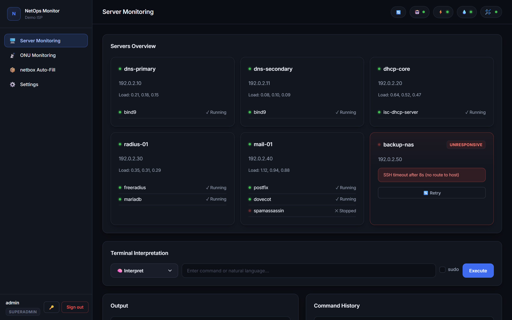
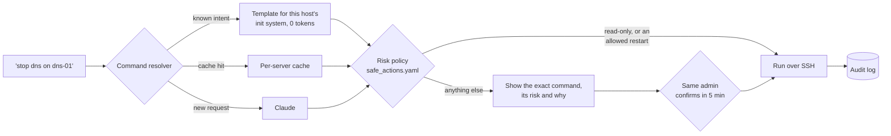
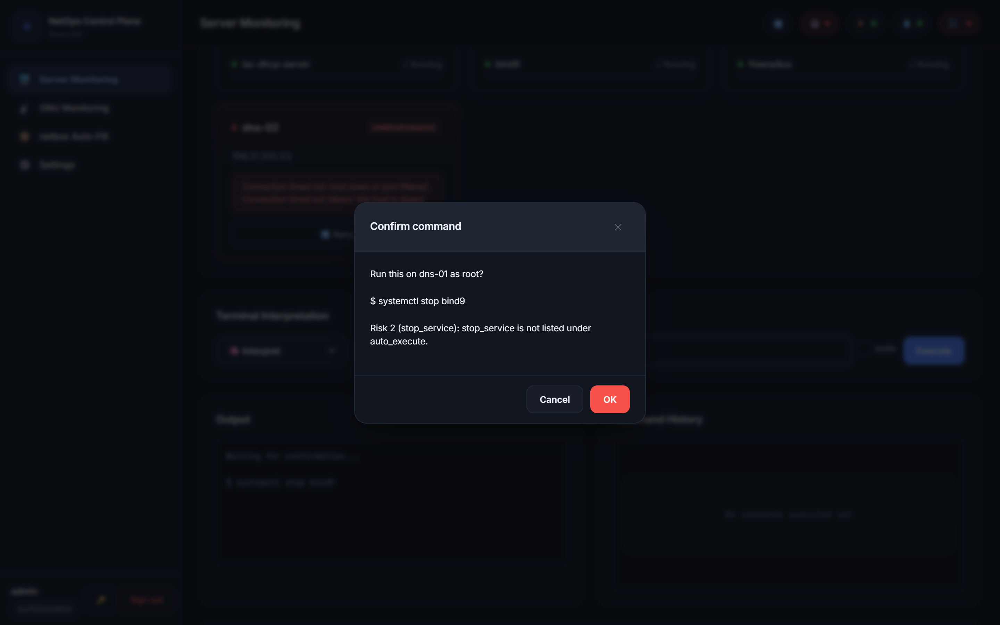
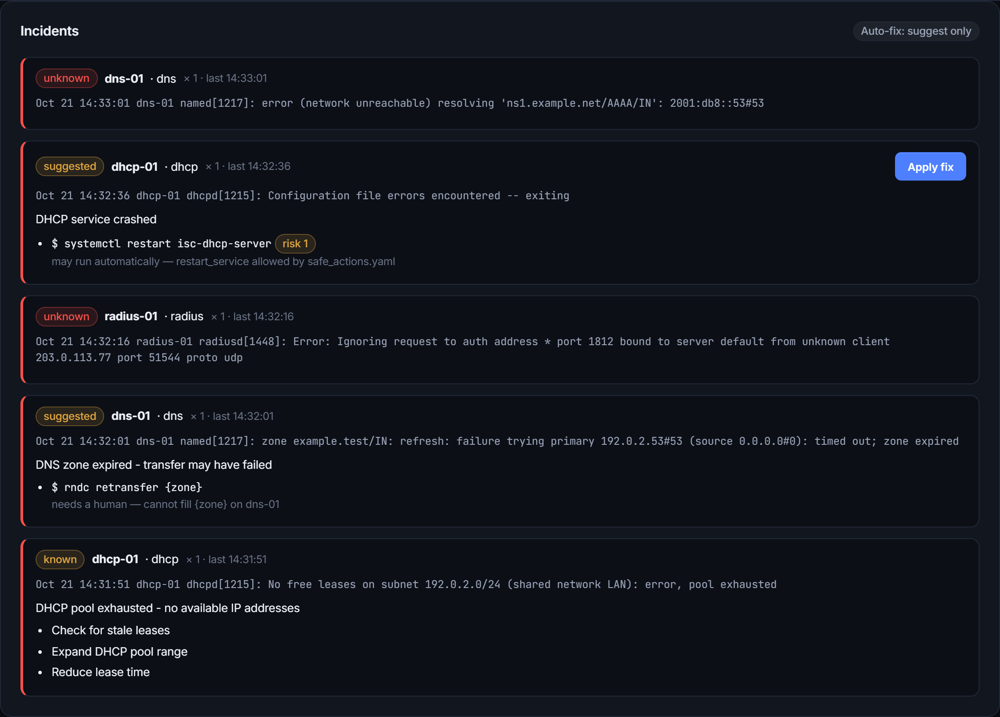
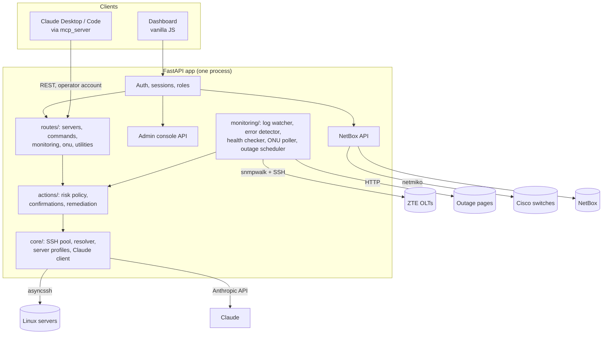

# NetOps Control Plane

> A self-hosted operations panel for a small ISP: it watches Linux servers over SSH, GPON OLTs over SNMP and utility outage feeds, turns plain-language requests into shell commands with Claude, and fixes known failures under an explicit risk policy.

[](https://github.com/Madly222/netops-control-plane/actions/workflows/ci.yml)


[](LICENSE)

<p align="center">
  
</p>

## Try it in a minute

```bash
docker compose up
```

Open http://localhost:4455 and sign in as `admin` / `demo-password` (`ops` is an admin, `viewer` is read-only).

Demo mode runs the real application against simulated infrastructure: three Linux servers plus one unreachable host, two ZTE OLTs with 32 ONUs, and a planned power outage. Within a minute errors start appearing in the server logs and the **Incidents** card fills with fix plans. In the terminal try `restart dhcp on dhcp-01` (runs at once) or `stop dns on dns-01` (asks for confirmation). Nothing outside the container is contacted. Set `ANTHROPIC_API_KEY` to let Claude interpret free-form requests and diagnose errors that match no known pattern.

Without Docker: `pip install -r requirements.txt && DEMO_MODE=1 python -m src.main`.

---

## What it does

| Area | What the operator gets |
|------|------------------------|
| **Servers** | Live status of DHCP (ISC, Kea, dnsmasq), DNS (bind9, Technitium, unbound, PowerDNS) and FreeRADIUS on systemd and SysVinit hosts: health checks, diagnostics, restarts, hardware and network report. |
| **Logs and incidents** | `tail -F` over SSH, matched against a YAML knowledge base of error patterns. Known errors get a fix plan; unknown ones get a diagnosis from Claude. |
| **Terminal** | Plain-language requests (*"error logs for today for dns"*, *"restart dhcp on dhcp-01"*) rendered to the right command for each host's init system, with Claude as the fallback for anything new. A raw SSH console for admins. |
| **GPON** | Per-OLT view of ONUs on ZTE C320: optical levels, low signal, offline reason, registration, MAC and serial. |
| **NetBox** | Scan a Cisco switch or router over SSH and push interfaces, VLANs, cables and CDP neighbours to NetBox; sync MAC addresses from the DHCP database and assign them to switch ports. |
| **Outages** | Daily checks of the electricity and water providers' planned-outage pages for the addresses you care about, with e-mail alerts. |
| **Administration** | Users and roles, live server/OLT configuration, notification settings, `.env` editor, audit log. |
| **MCP server** | Read-only [Model Context Protocol](https://modelcontextprotocol.io) tools so Claude Desktop or Claude Code can ask about status, errors, ONUs and outages ([mcp_server/](mcp_server/README.md)). |

A visual tour, one tree per area: [docs/features](docs/features/README.md). All 28 screens: [docs/SCREENSHOTS.md](docs/SCREENSHOTS.md).

## How AI commands stay safe

The interesting part of the project is letting a language model near production shell access without trusting it.



| A risky command waits for the operator | Known errors come with a fix plan |
|---|---|
|  |  |

- **Templates first.** Most requests are status, logs, errors or a restart. The resolver renders those from a per-host capability profile (systemd or SysVinit, journald or log files) without calling Claude, and caches whatever Claude resolves per server.
- **Risk policy.** Every command the app builds, from a template or from Claude, is classified by `src/actions/policy.py`: read-only programs are risk 0, restarts follow `config/safe_actions.yaml`, `stop` is risk 2, and anything unrecognised, writing to a file or using command substitution is risk 3. Pipes and `||` chains take the risk of their worst part, and quoting is respected. Only risk-0 commands and restarts of listed services run without a human.
- **Confirmation.** Anything else comes back to the dashboard with the exact command, its risk and the reason. It runs only when the same admin confirms it within five minutes. Both steps go to the audit log.
- **Remediation.** Known errors carry fix commands. `auto_remediation.mode` is `suggest` by default (a human applies the fix); in `auto` the policy decides what runs, within per-action cooldowns, hourly caps and a backoff after repeated failures. Claude's suggested fixes for unknown errors are shown, never run.
- **Shell hygiene.** Paths, patterns and service names are quoted or validated before they reach a remote shell, and `sudo` wraps the whole command, not just the first program in a pipe.

## Architecture



Details: [docs/ARCHITECTURE.md](docs/ARCHITECTURE.md). Every source module with its role and the gotchas: [docs/AGENTS.md](docs/AGENTS.md).

## Tech stack

- **Backend:** Python 3.10+, FastAPI, Uvicorn, Pydantic, asyncssh, netmiko/paramiko, pynetbox, loguru
- **AI:** Anthropic SDK (`AsyncAnthropic`), default model `claude-opus-5-5` at low effort; MCP server on the official `mcp` SDK
- **Frontend:** vanilla HTML/CSS/JS, no build step
- **Ops:** Docker image with a `/data` volume, systemd units for bare-metal installs, GitHub Actions running ruff, pytest on 3.10–3.12 and a demo-container smoke test

## Running it for real

**Docker.** Put `secrets.yaml`, `.env` and `keys/` next to `docker-compose.yml`, then:

```bash
touch .env
cp -n config/electric_addresses.example.txt config/electric_addresses.txt
docker compose --profile prod up -d monitor
```

**Bare metal.**

```bash
git clone https://github.com/Madly222/netops-control-plane.git
cd netops-control-plane
python3 -m venv venv && source venv/bin/activate
pip install -r requirements.txt
cp secrets.example.yaml secrets.yaml   # servers, SSH credentials, Claude key, users, OLTs
cp .env.example .env                   # SMTP, NetBox, outage jobs (optional)
python -m src.main                     # http://localhost:4455
```

System packages: `openssh-client`, `snmp` (GPON) and `mysql-client` (DHCP→NetBox MAC sync). The systemd unit, timers and hardening checklist are in [docs/DEPLOYMENT.md](docs/DEPLOYMENT.md).

## Configuration

| File | Holds |
|------|-------|
| `secrets.yaml` | Servers and SSH credentials, OLTs, Claude key and model, web users, session and login-lockout settings. Seeds the runtime store on first start; after that, users, servers and OLTs are edited in the admin console. |
| `.env` | SMTP, NetBox, DHCP database and switch credentials for the automation jobs; editable from the console. |
| `config/settings.yaml` | Intervals, dedup window, Claude cache and rate limit, `auto_remediation` mode. |
| `config/safe_actions.yaml` | The risk policy: what may run without a human, cooldowns, limits. |
| `knowledge_base/*.yaml` | Known error patterns with diagnoses and fixes; noise filters. |

Environment variables `MONITOR_DATA_DIR`, `MONITOR_SECRETS_FILE`, `DEMO_MODE` and `ANTHROPIC_API_KEY` are described with every other field in [docs/CONFIGURATION.md](docs/CONFIGURATION.md).

## Security model

- Three roles: `operator` reads, `admin` runs commands, confirms risky ones and writes to NetBox, `superadmin` also manages users and configuration. [`tests/test_route_roles.py`](tests/test_route_roles.py) pins the required role of each of the 75 routes, so a new endpoint fails CI until someone decides who may call it.
- Passwords are bcrypt-hashed, at least 10 characters. Sessions are random 256-bit tokens in an HttpOnly, SameSite=Lax cookie (`Secure` behind HTTPS); the server stores only their SHA-256. Roles are re-read on every request, so demotions and deletions apply at once, and password changes end the user's other sessions.
- Repeated failed logins lock the username and the client IP out (HTTP 429).
- SSH host keys are trusted on first use and checked on every later connection. Servers can use SSH keys and `NOPASSWD` sudo, so no server password needs to be stored.
- Secrets live in `secrets.yaml`, `.env` and `keys/`, all gitignored and outside the image; files the app writes with credentials or sessions are owner-only (0600). CORS is off unless origins are listed.
- Every privileged action, including each command and its confirmation, is written to an append-only audit log.

## Tests and CI

```bash
pip install pytest ruff
ruff check .
python -m pytest -q
```

About 140 tests cover the risk classifier and limiter, the confirmation flow over HTTP, remediation in each mode, the command resolver's templates per init system, sessions, login lockout and role checks, shell quoting, the Claude client against a fake API, and the demo hosts. CI runs them on Python 3.10–3.12, then builds the Docker image, starts the demo and checks that it serves the fleet. Scripts that need live servers are in `scripts/check_*.py`.

## Background and design decisions

This is an internal tool for the network operations team of a small ISP, in production for about half a year against the company's real equipment: 5 Linux servers (DHCP, DNS, RADIUS) and 2 ZTE C320 OLTs, plus the Cisco switches and routers behind NetBox. Up to five engineers have access; one of them is the main user and drove most of the requirements.

Before it, none of this was automated: service checks, log reading, ONU signal checks, finding which switch port a subscriber's MAC is on, keeping NetBox in sync with the cabling and watching the utilities' outage pages were all done by hand. The app grew one tool at a time, each added when a colleague needed a piece of their daily work automated, which is why it is a toolbox for one team rather than a single-purpose product. Before publication it was cleaned up: tests, CI, the risk policy, the demo and this documentation were added (see [CHANGELOG.md](CHANGELOG.md)).

- **Templates before the model.** Status, logs and restarts are most of the traffic. Rendering them from a cached host profile costs no tokens and behaves the same every time; Claude handles the long tail, and its answers are cached per host profile.
- **Classify commands instead of trusting the model's own "safe" flag.** The prompt asks Claude to refuse destructive requests, but the decision to run something is made by deterministic code reading a policy file the operator controls.
- **One process, no database.** The fleet is small, so state lives in JSON files written atomically under one data directory. That keeps deployment to a single container or systemd unit; the trade-off is no horizontal scaling.
- **Vanilla frontend.** No build step means anyone on the team can fix the dashboard on the server with an editor.
- **A demo that runs the real code.** The simulation sits below the SSH layer, so detection, health checks, the resolver, the policy and remediation all run unchanged against it. Building it surfaced a real bug: service detection treated `"not found"` as found, so every DNS server was detected as Technitium.

## Project layout

```
src/
├── main.py                 # entry point: python -m src.main
├── core/                   # config, SSH pool, command resolver, server profiles, Claude client
├── actions/                # risk policy, pending confirmations, remediation
├── services/               # DHCP / DNS / RADIUS handlers and their registry
├── monitoring/             # log watcher, error detector, health checker, ONU poller, outage jobs, NetBox syncs
├── web/                    # FastAPI app, auth, users, admin console, audit, routes/
└── demo/                   # simulated hosts, OLTs and outage feeds for DEMO_MODE
mcp_server/                 # read-only MCP server for Claude Desktop / Claude Code
services/netbox-autofill/   # Cisco → NetBox scanner (netmiko)
config/                     # settings.yaml, safe_actions.yaml, services/*.yaml
knowledge_base/             # known_errors.yaml, ignore_patterns.yaml
web/                        # dashboard (index.html, css/, js/)
demo/secrets.yaml           # demo configuration
tests/                      # pytest suite
scripts/                    # live check scripts, user management, systemd units
docs/                       # architecture, API, configuration, deployment, feature map, screenshots
```

## Documentation

- [ARCHITECTURE.md](docs/ARCHITECTURE.md): layers, runtime model, data flows
- [API.md](docs/API.md): every REST endpoint
- [CONFIGURATION.md](docs/CONFIGURATION.md): every configuration field and environment variable
- [DEPLOYMENT.md](docs/DEPLOYMENT.md): Docker, systemd, timers, hardening
- [AGENTS.md](docs/AGENTS.md): module map and conventions for contributors and coding agents
- [features/](docs/features/README.md): the feature map
- [CHANGELOG.md](CHANGELOG.md)

## License

[MIT](LICENSE)
