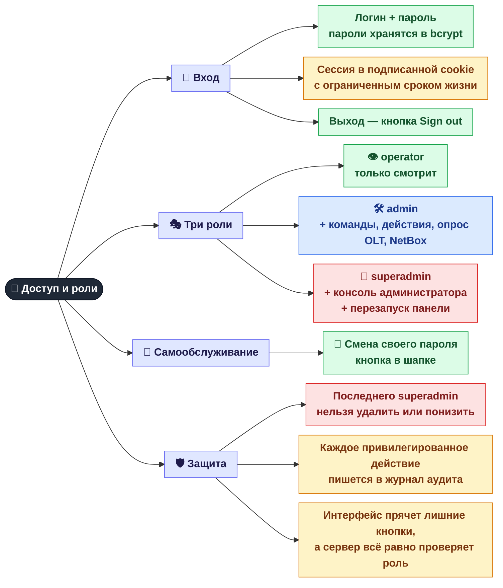

[← Карта](README.md) · **1 / 8** · [Дальше: Серверы и сервисы →](02-servers.md)

# 🔐 Доступ и роли

Кто может войти в панель, что ему разрешено и как это контролируется.

## Кто что может

| Возможность | 👁 operator | 🛠 admin | 👑 superadmin |
|-------------|:-:|:-:|:-:|
| Смотреть серверы, ONU, индикаторы, отчёты | ✅ | ✅ | ✅ |
| Сменить свой пароль | ✅ | ✅ | ✅ |
| Запустить проверку отключений «сейчас» | ✅ | ✅ | ✅ |
| Терминал: AI-команды и прямая SSH-консоль | — | ✅ | ✅ |
| Рестарт / reload сервисов на серверах | — | ✅ | ✅ |
| Опрос OLT «сейчас» | — | ✅ | ✅ |
| NetBox: сканирование, применение, синхронизации | — | ✅ | ✅ |
| Консоль администратора (вкладка **Admin**) | — | — | ✅ |
| 🔄 Перезапуск самой панели (`mcp-monitor`) | — | — | ✅ |

## Где это в коде

| Что | Файл |
|-----|------|
| Вход, выход, смена пароля, проверка ролей | `src/web/auth.py` |
| Хранилище пользователей (`sessions/users.json`) | `src/web/users.py` |
| Журнал аудита (`logs/audit.jsonl`) | `src/web/audit.py` |
| Управление пользователями из консоли | `scripts/manage_users.py` |

---
[← Карта](README.md) · [Дальше: Серверы и сервисы →](02-servers.md)
