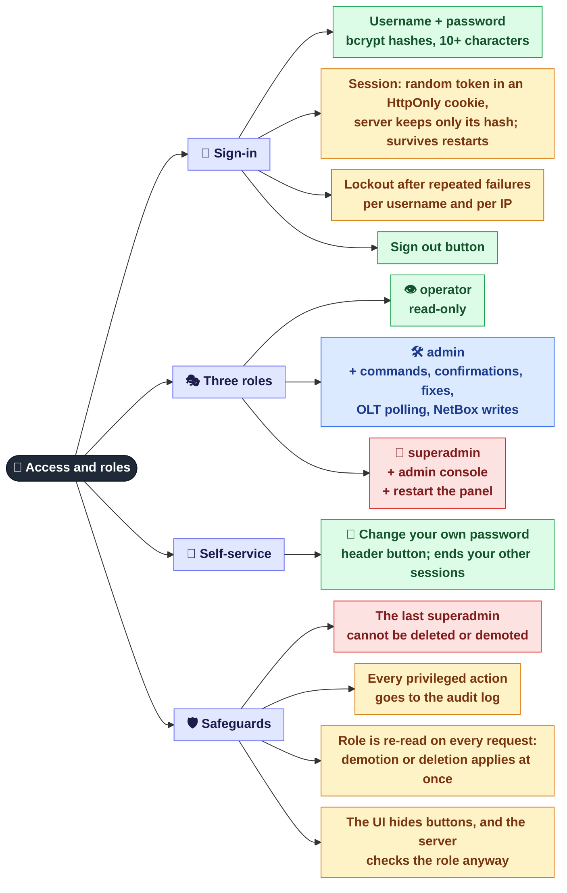

[← Map](README.md) · **1 / 8** · [Next: Servers and services →](02-servers.md)

# 🔐 Access and roles

Who can sign in to the panel, what they are allowed to do, and how that is enforced.

## Who can do what

| Capability | 👁 operator | 🛠 admin | 👑 superadmin |
|------------|:-:|:-:|:-:|
| View servers, ONUs, incidents, indicators, reports | ✅ | ✅ | ✅ |
| Change own password | ✅ | ✅ | ✅ |
| Run an outage check "now" | ✅ | ✅ | ✅ |
| Terminal: AI commands and the raw SSH console | — | ✅ | ✅ |
| Confirm a risky command, apply a suggested fix | — | ✅ | ✅ |
| Restart / reload services on servers | — | ✅ | ✅ |
| Poll an OLT "now" | — | ✅ | ✅ |
| NetBox: scan, apply, sync MACs and ports | — | ✅ | ✅ |
| Admin console (**Admin** tab) | — | — | ✅ |
| 🔄 Restart the panel itself (`mcp-monitor`) | — | — | ✅ |

The required role of every API route is listed in `tests/test_route_roles.py`; a new route fails the tests until it is added there.

## Where it is in the code

| What | File |
|------|------|
| Sign-in, sessions, lockout, role checks | `src/web/auth.py` |
| User store (`sessions/users.json`) | `src/web/users.py` |
| Audit log (`logs/audit.jsonl`) | `src/web/audit.py` |
| User management from the command line | `scripts/manage_users.py` |

---
[← Map](README.md) · [Next: Servers and services →](02-servers.md)
