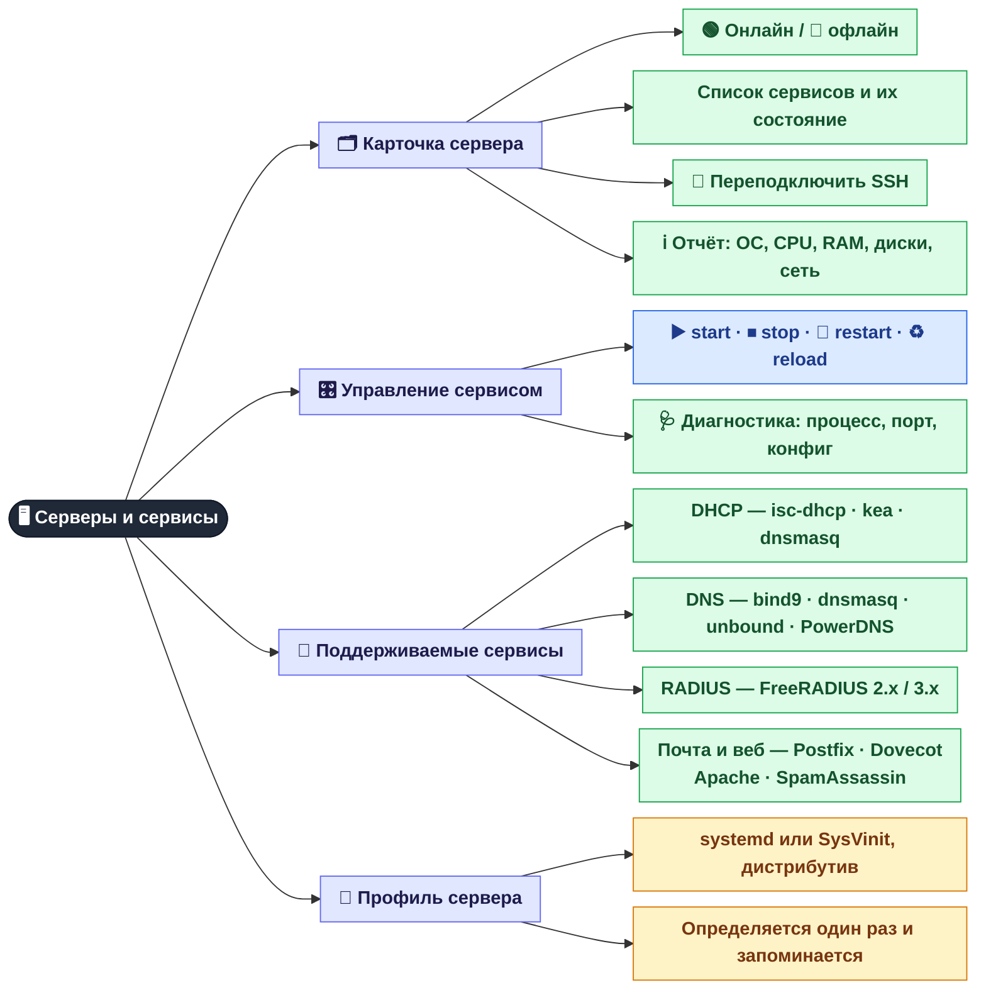

[← Доступ и роли](01-access.md) · **2 / 8** · [Карта](README.md) · [Дальше: Фоновый мониторинг →](03-monitoring.md)

# 🖥️ Серверы и сервисы

Вкладка **Servers** — карточки всех серверов, которые панель обслуживает по SSH, и управление их сервисами.

## Зачем это нужно

| Ветка | Зачем |
|-------|-------|
| 🗂️ Карточка | За секунду видно, какой сервер лежит и какой сервис на нём упал |
| 🎛️ Управление | Перезапустить DHCP/DNS/RADIUS из браузера, не заходя по SSH |
| 🧩 Сервисы | Тип сервера определяется автоматически — панель сама находит конфиги, логи и файлы аренд. DHCP показывает аренды и пулы, DNS проверяет резолв тестовой зоны, почта и веб — только статус и рестарт |
| 🧬 Профиль | Одна и та же кнопка «restart» работает и на systemd, и на старом SysVinit |

> Добавить, изменить или убрать сервер можно во вкладке **Admin → Servers** — см. [👑 Консоль superadmin](08-admin.md).

## Где это в коде

| Что | Файл |
|-----|------|
| SSH-подключения, выполнение команд | `src/core/ssh_manager.py` |
| Отчёт о сервере | `src/core/system_info.py` |
| Профиль сервера (`sessions/server_profiles.json`) | `src/core/server_profile.py` |
| DHCP / DNS / RADIUS | `src/services/dhcp.py`, `dns.py`, `radius.py` + `config/services/*.yaml` |

---
[← Доступ и роли](01-access.md) · [Карта](README.md) · [Дальше: Фоновый мониторинг →](03-monitoring.md)
