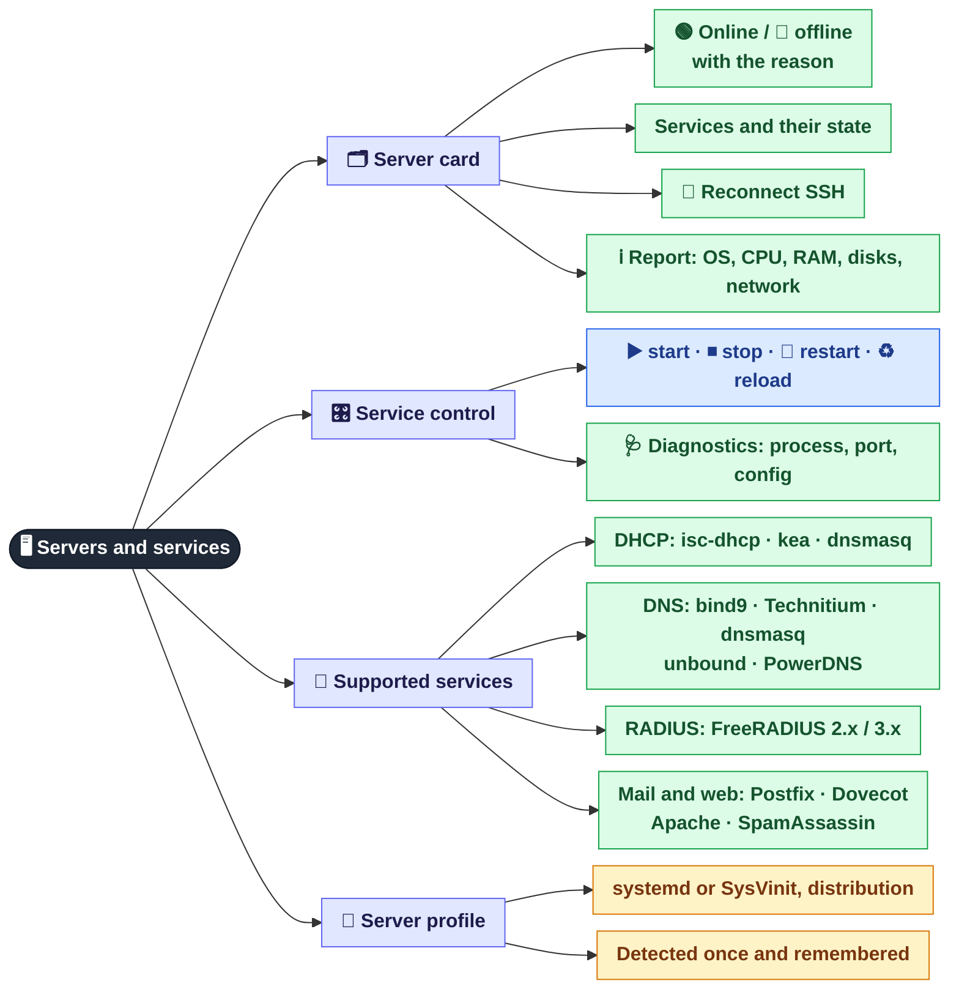

[← Access and roles](01-access.md) · **2 / 8** · [Map](README.md) · [Next: Background monitoring →](03-monitoring.md)

# 🖥️ Servers and services

The **Servers** tab: a card for every server the panel manages over SSH, and control of their services.

## Why it exists

| Branch | Why |
|--------|-----|
| 🗂️ Card | See at a glance which server is down and which service failed on it, and why the connection failed |
| 🎛️ Control | Restart DHCP/DNS/RADIUS from the browser without an SSH session |
| 🧩 Services | The service variant is detected automatically, so the panel finds configs, logs and lease files on its own. DHCP shows leases and pools, DNS checks that a test zone resolves, mail and web get status and restart only |
| 🧬 Profile | The same "restart" button works on systemd and on old SysVinit hosts |

> Servers are added, changed or removed in **Admin → Servers**; see [👑 Superadmin console](08-admin.md).

## Where it is in the code

| What | File |
|------|------|
| SSH connections, command execution, quoting | `src/core/ssh_manager.py` |
| Server report | `src/core/system_info.py` |
| Server profile (`sessions/server_profiles.json`) | `src/core/server_profile.py` |
| DHCP / DNS / RADIUS | `src/services/dhcp.py`, `dns.py`, `radius.py`, registered in `src/services/registry.py`, with `config/services/*.yaml` |
| Endpoints | `src/web/routes/servers.py` |

---
[← Access and roles](01-access.md) · [Map](README.md) · [Next: Background monitoring →](03-monitoring.md)
