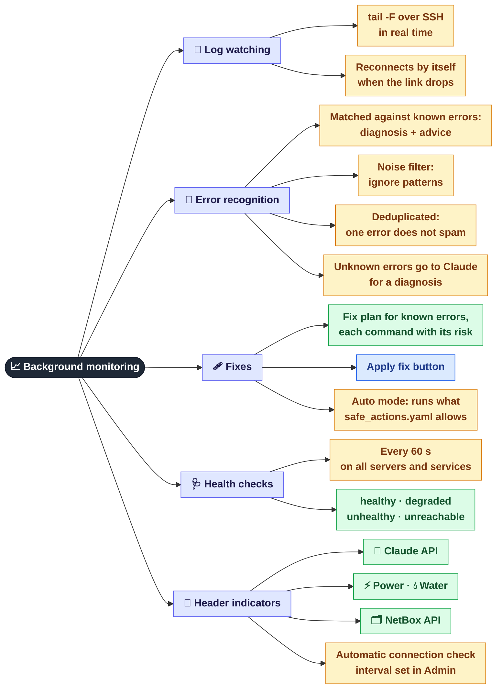
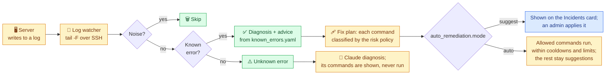

[← Servers and services](02-servers.md) · **3 / 8** · [Map](README.md) · [Next: Terminal and AI commands →](04-terminal.md)

# 📈 Background monitoring

What the panel does **on its own**, without anyone pressing a button: it watches logs, recognises errors, plans or applies fixes, and checks server health.

## What happens to a log line

The mode is set in `config/settings.yaml > auto_remediation.mode`: `off`, `suggest` (default) or `auto`. Every automatic or applied fix is written to the audit log.

## Where it is in the code

| What | File |
|------|------|
| Log watching | `src/monitoring/log_watcher.py` |
| Error recognition | `src/monitoring/error_detector.py` |
| Error and noise knowledge base | `knowledge_base/known_errors.yaml`, `knowledge_base/ignore_patterns.yaml` |
| Fix plans, auto mode, Claude diagnosis | `src/actions/remediation.py` |
| Risk policy and limits | `src/actions/policy.py`, `config/safe_actions.yaml` |
| Health checks | `src/monitoring/health_checker.py` |
| Intervals, thresholds, mode | `config/settings.yaml` |
| Starting the background tasks | `src/web/app.py` (lifespan) |

---
[← Servers and services](02-servers.md) · [Map](README.md) · [Next: Terminal and AI commands →](04-terminal.md)
