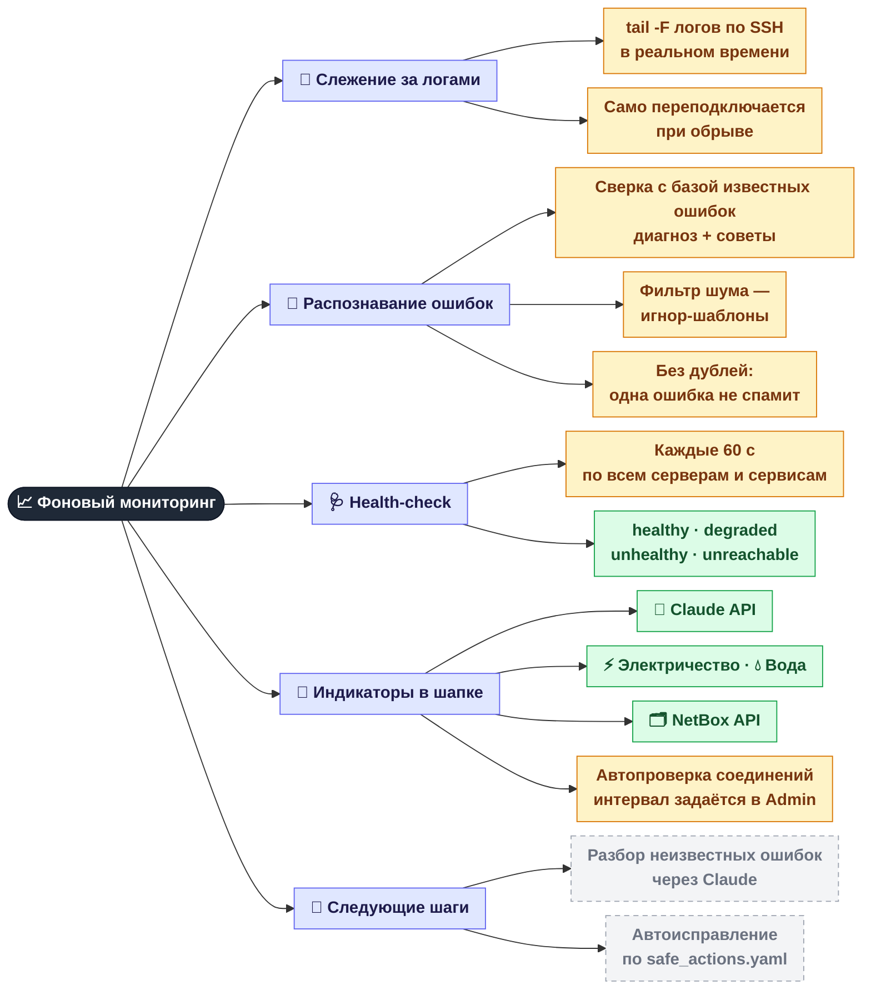
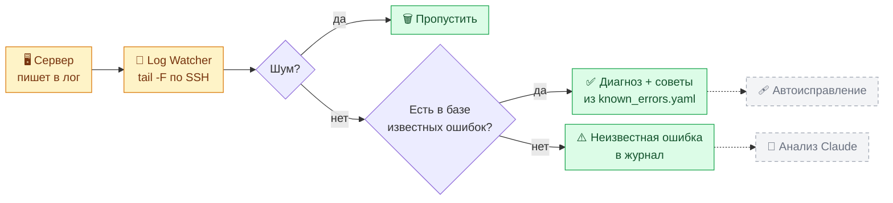

[← Серверы и сервисы](02-servers.md) · **3 / 8** · [Карта](README.md) · [Дальше: Терминал и AI-команды →](04-terminal.md)

# 📈 Фоновый мониторинг

То, что панель делает **сама**, без нажатия кнопок: следит за логами, распознаёт ошибки и проверяет здоровье серверов.

## Что происходит со строкой лога

> Пунктир — функции, для которых код уже есть (`claude_client.py`, `safe_actions.yaml`), но в цепочку они ещё не подключены.

## Где это в коде

| Что | Файл |
|-----|------|
| Слежение за логами | `src/monitoring/log_watcher.py` |
| Распознавание ошибок | `src/monitoring/error_detector.py` |
| База ошибок и шума | `knowledge_base/known_errors.yaml`, `knowledge_base/ignore_patterns.yaml` |
| Health-check | `src/monitoring/health_checker.py` |
| Интервалы и пороги | `config/settings.yaml` |
| Запуск всех фоновых задач | `src/web/app.py` (lifespan) |

---
[← Серверы и сервисы](02-servers.md) · [Карта](README.md) · [Дальше: Терминал и AI-команды →](04-terminal.md)
