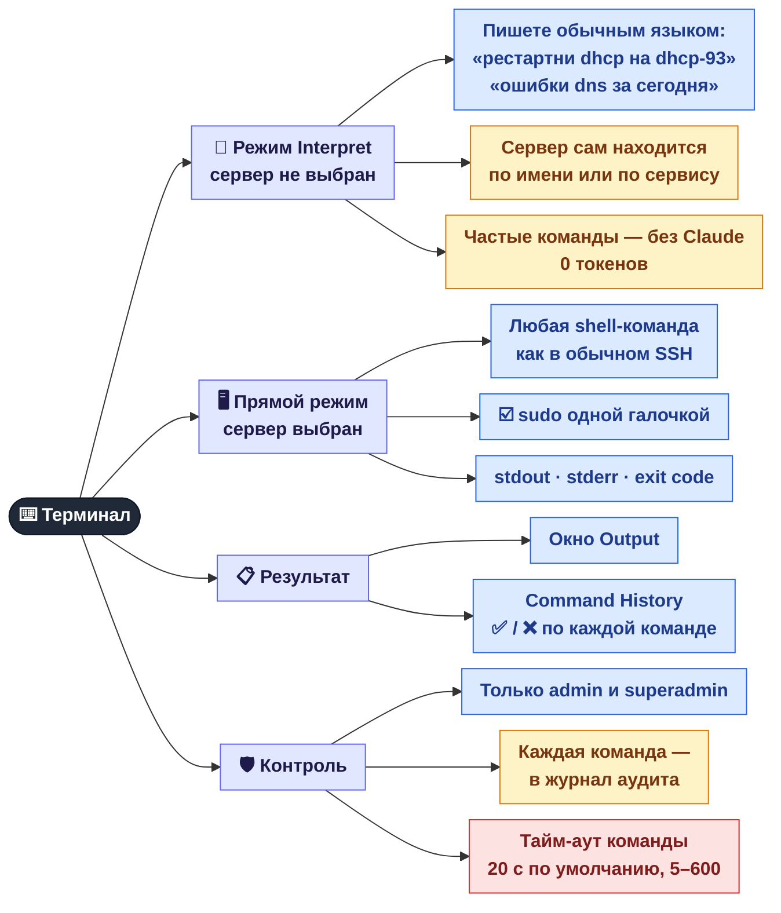
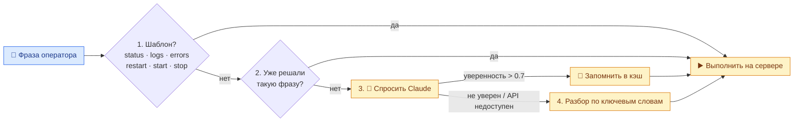

[← Фоновый мониторинг](03-monitoring.md) · **4 / 8** · [Карта](README.md) · [Дальше: GPON / ONU →](05-onu.md)

# ⌨️ Терминал и AI-команды

Блок **Terminal Interpretation** на вкладке **Servers**. Один ввод — два режима: выбор в выпадающем списке слева решает, кто выполнит команду.

## Как фраза превращается в команду (режим Interpret)

Сначала пробуются бесплатные способы, Claude — только если они не сработали.

| Шаг | Стоимость | Пояснение |
|-----|-----------|-----------|
| 1. Шаблон | 0 токенов | Команда собирается под профиль сервера (systemd / SysVinit) |
| 2. Кэш | 0 токенов | Ответ Claude на ту же фразу для того же типа сервера |
| 3. Claude | токены | Только для новых, нестандартных запросов |
| 4. Ключевые слова | 0 токенов | Запасной вариант, если Claude не уверен или недоступен |

## Где это в коде

| Что | Файл |
|-----|------|
| Разбор фраз: шаблоны + кэш | `src/core/command_resolver.py` |
| Обращение к Claude | `src/core/claude_client.py` |
| Эндпоинты `/api/execute`, `/api/console/exec` | `src/web/api.py` |
| Кнопка Execute, история | `web/js/app.js` |

---
[← Фоновый мониторинг](03-monitoring.md) · [Карта](README.md) · [Дальше: GPON / ONU →](05-onu.md)
