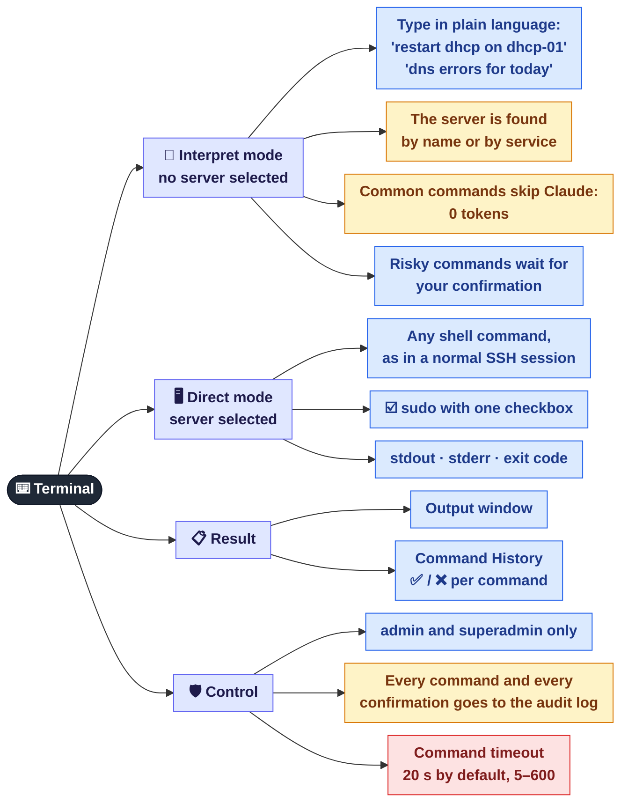
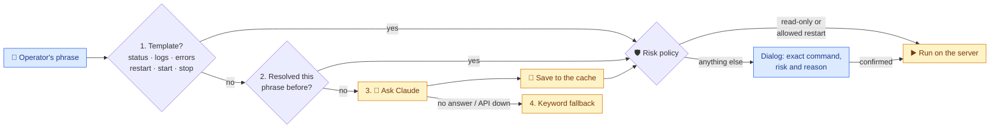

[← Background monitoring](03-monitoring.md) · **4 / 8** · [Map](README.md) · [Next: GPON / ONU →](05-onu.md)

# ⌨️ Terminal and AI commands

The **Terminal Interpretation** block on the **Servers** tab. One input, two modes: the drop-down on the left decides who runs the command.

## How a phrase becomes a command (Interpret mode)

The free ways are tried first; Claude is asked only when they do not work. Whatever command comes out goes through the risk policy before it runs.

| Step | Cost | Notes |
|------|------|-------|
| 1. Template | 0 tokens | The command is built for the server's profile (systemd / SysVinit) |
| 2. Cache | 0 tokens | Claude's earlier answer to the same phrase for the same kind of server |
| 3. Claude | tokens | Only for new, unusual requests |
| 4. Keywords | 0 tokens | Fallback when Claude has no answer or is unavailable |

Risk levels come from `config/safe_actions.yaml`: read-only commands are risk 0, restarts of listed services risk 1, `stop` risk 2, anything unrecognised risk 3. Only risk 0 and allowed restarts run without the dialog; a confirmation is valid for the same user for 5 minutes.

## Where it is in the code

| What | File |
|------|------|
| Phrase parsing: templates + cache | `src/core/command_resolver.py` |
| Calls to Claude | `src/core/claude_client.py` |
| Risk classification, pending confirmations | `src/actions/policy.py`, `src/actions/pending.py` |
| `/api/execute`, `/api/execute/confirm`, `/api/console/exec` | `src/web/routes/commands.py` |
| Execute button, confirmation dialog, history | `web/js/app.js` |

---
[← Background monitoring](03-monitoring.md) · [Map](README.md) · [Next: GPON / ONU →](05-onu.md)
