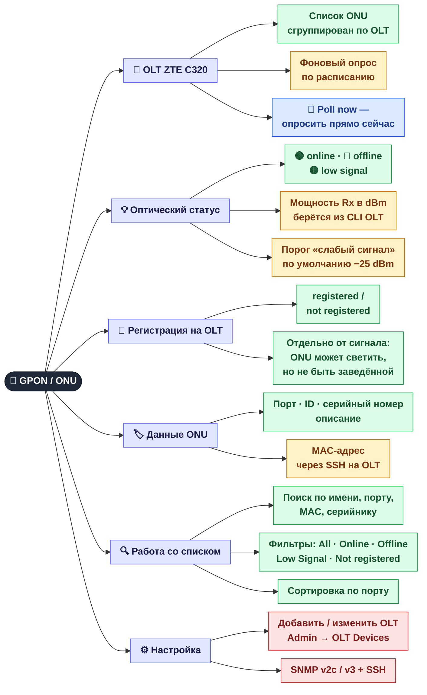

[← Терминал и AI-команды](04-terminal.md) · **5 / 8** · [Карта](README.md) · [Дальше: NetBox →](06-netbox.md)

# 📡 GPON / ONU

Вкладка **ONU** — абонентские терминалы на OLT ZTE C320: есть ли сигнал, какой он, зарегистрирована ли ONU.

## Зачем разделены «сигнал» и «регистрация»

| Сигнал | Регистрация | Что это значит на практике |
|--------|-------------|----------------------------|
| 🟢 online | registered | Всё в порядке |
| 🟡 low signal | registered | Абонент работает, но линию пора проверять (грязный коннектор, изгиб) |
| 🔴 offline | registered | Нет света: ONU выключена или обрыв |
| 🟢 online | not registered | ONU светит, но не заведена на OLT — нужна регистрация |

> Фильтр **Not registered** как раз находит четвёртый случай — ONU, которые физически подключены, но не обслуживаются.

## Где это в коде

| Что | Файл |
|-----|------|
| Опрос OLT, сигнал, регистрация, MAC | `src/monitoring/onu_monitor.py` |
| Эндпоинты `/api/onu/*` | `src/web/api.py` |
| Вкладка ONU: поиск, фильтры | `web/js/onu.js` |

---
[← Терминал и AI-команды](04-terminal.md) · [Карта](README.md) · [Дальше: NetBox →](06-netbox.md)
