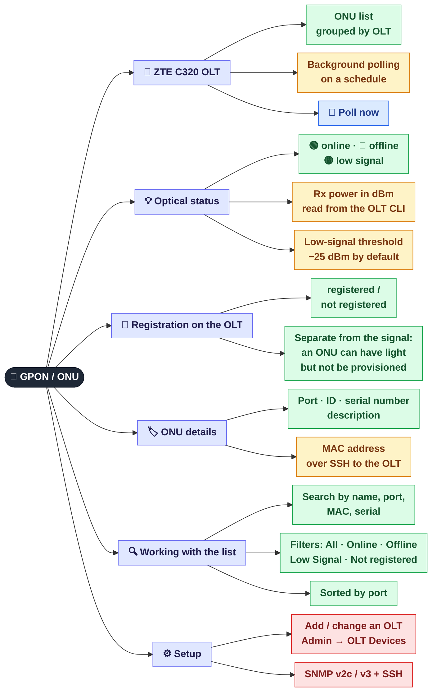

[← Terminal and AI commands](04-terminal.md) · **5 / 8** · [Map](README.md) · [Next: NetBox →](06-netbox.md)

# 📡 GPON / ONU

The **ONU** tab: subscriber terminals on ZTE C320 OLTs. Is there a signal, how strong is it, is the ONU registered.

## Why "signal" and "registration" are separate

| Signal | Registration | What it means in practice |
|--------|--------------|---------------------------|
| 🟢 online | registered | All good |
| 🟡 low signal | registered | The subscriber works, but the line needs a look (dirty connector, tight bend) |
| 🔴 offline | registered | No light: the ONU is off or the fibre is cut |
| 🟢 online | not registered | The ONU has light but is not provisioned on the OLT; it needs registering |

> The **Not registered** filter finds exactly the fourth case: ONUs that are physically connected but not served.

## Where it is in the code

| What | File |
|------|------|
| OLT polling, signal, registration, MAC | `src/monitoring/onu_monitor.py` |
| `/api/onu/*` endpoints | `src/web/routes/onu.py` |
| ONU tab: search, filters | `web/js/onu.js` |

---
[← Terminal and AI commands](04-terminal.md) · [Map](README.md) · [Next: NetBox →](06-netbox.md)
