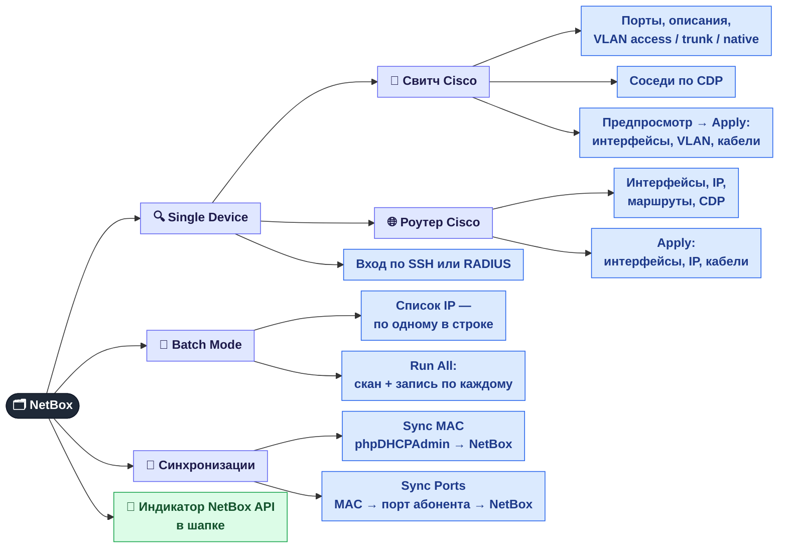
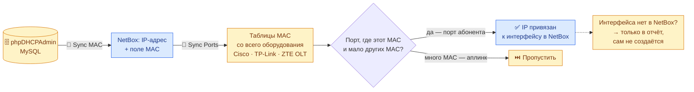

[← GPON / ONU](05-onu.md) · **6 / 8** · [Карта](README.md) · [Дальше: Отключения света и воды →](07-outages.md)

# 🗂️ NetBox

Вкладка **NetBox** — панель сама заполняет NetBox данными с реального оборудования, чтобы не переносить их руками.
Все действия — для **admin** и **superadmin**.

## Как работают синхронизации

Две кнопки работают **по цепочке**: сначала MAC попадают в NetBox, потом по ним находится порт абонента.

| Кнопка | Откуда | Куда | Зачем |
|--------|--------|------|-------|
| 🔍 Scan → Apply | свитч / роутер по SSH | интерфейсы, VLAN, IP, кабели | NetBox отражает реальную коммутацию |
| 🚀 Run All | список IP | то же самое пачкой | обойти весь узел за раз |
| 🔄 Sync MAC | база phpDHCPAdmin | поле MAC у IP-адреса | знать, какое устройство за каким IP |
| 🔗 Sync Ports | MAC-таблицы оборудования | привязка IP к интерфейсу | видеть, в каком порту сидит абонент |

## Где это в коде

| Что | Файл |
|-----|------|
| Эндпоинты `/api/netbox/*` | `src/web/api_netbox.py` |
| SSH к Cisco (в т.ч. старые IOS) | `services/netbox-autofill/ssh_connector.py` |
| Запись в NetBox | `services/netbox-autofill/netbox_client.py`, `orchestrator.py` |
| Sync MAC / Sync Ports | `src/monitoring/dhcp_mac_sync.py`, `src/monitoring/mac_port_sync.py` |
| Вкладка NetBox | `web/js/netbox.js` |

---
[← GPON / ONU](05-onu.md) · [Карта](README.md) · [Дальше: Отключения света и воды →](07-outages.md)
