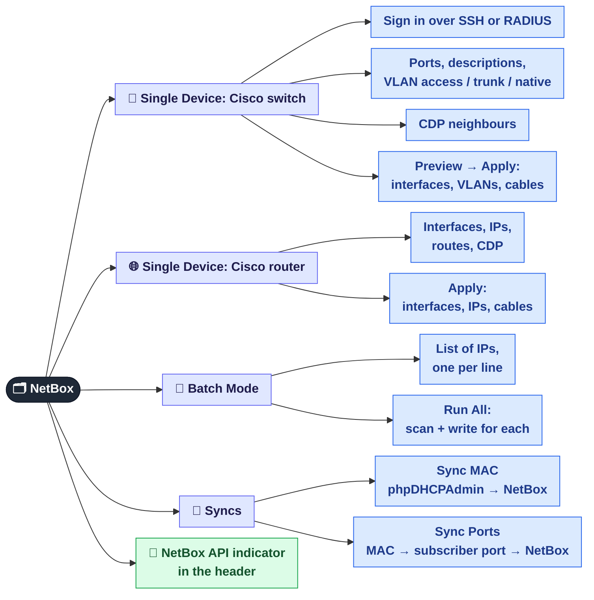

[← GPON / ONU](05-onu.md) · **6 / 8** · [Map](README.md) · [Next: MAC sync →](06a-netbox-mac-sync.md)

# 🗂️ NetBox

The **NetBox** tab: the panel fills NetBox with data from the real equipment, so nobody has to copy it by hand.
Every action here needs **admin** or **superadmin**: even a scan can write to NetBox (it renames a device whose name differs from its hostname).

This is the overview. The details are on two separate pages:

| Details | What's inside |
|---------|---------------|
| [🔄 MAC and port sync](06a-netbox-mac-sync.md) | where the MACs come from, how a subscriber's port is found, what each status in the report means, settings |
| [🔗 CDP and auto-fill](06b-netbox-cdp.md) | which commands run on the Cisco, how the CDP neighbour is found, what exactly is written to NetBox, what to check before Apply |

| Button | From | To | Why | Details |
|--------|------|----|-----|:-:|
| 🔍 Scan → Apply | switch / router over SSH + CDP | interfaces, VLANs, IPs, cables | NetBox reflects the real cabling | [6b](06b-netbox-cdp.md) |
| 🚀 Run All | list of switch IPs | the same in bulk, without a preview | cover a whole site in one go | [6b](06b-netbox-cdp.md) |
| 🔄 Sync MAC | phpDHCPAdmin database | MAC field of the IP address | know which device sits behind which IP | [6a](06a-netbox-mac-sync.md) |
| 🔗 Sync Ports | MAC tables of Cisco, TP-Link, D-Link, MikroTik, ZTE OLT | IP assigned to an interface | see which port a subscriber is on | [6a](06a-netbox-mac-sync.md) |

## Where it is in the code

| What | File |
|------|------|
| `/api/netbox/*` endpoints | `src/web/api_netbox.py` |
| SSH to Cisco (old IOS included) | `services/netbox-autofill/ssh_connector.py` |
| Writing to NetBox | `services/netbox-autofill/netbox_client.py`, `orchestrator.py` |
| Sync MAC / Sync Ports | `src/monitoring/dhcp_mac_sync.py`, `src/monitoring/mac_port_sync.py` |
| NetBox tab | `web/js/netbox.js` |

---
[← GPON / ONU](05-onu.md) · [Map](README.md) · [Next: MAC sync →](06a-netbox-mac-sync.md)
