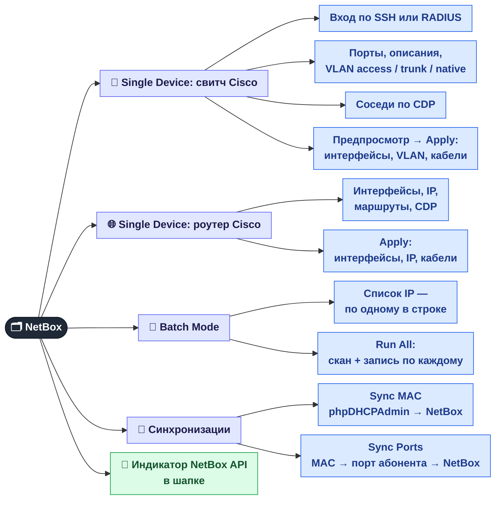

[← GPON / ONU](05-onu.md) · **6 / 8** · [Карта](README.md) · [Дальше: Синхронизация MAC →](06a-netbox-mac-sync.md)

# 🗂️ NetBox

Вкладка **NetBox** — панель сама заполняет NetBox данными с реального оборудования, чтобы не переносить их руками.
Все действия — для **admin** и **superadmin**.

Это обзорная страница. Подробности вынесены в две отдельные:

| Подробно | Что внутри |
|----------|-----------|
| [🔄 Синхронизация MAC и портов](06a-netbox-mac-sync.md) | откуда берутся MAC, как находится порт абонента, что значит каждый статус в отчёте, настройки |
| [🔗 CDP и автозаполнение](06b-netbox-cdp.md) | какие команды выполняются на Cisco, как ищется сосед по CDP, что именно пишется в NetBox, о чём помнить перед Apply |

| Кнопка | Откуда | Куда | Зачем | Подробно |
|--------|--------|------|-------|:-:|
| 🔍 Scan → Apply | свитч / роутер по SSH + CDP | интерфейсы, VLAN, IP, кабели | NetBox отражает реальную коммутацию | [6b](06b-netbox-cdp.md) |
| 🚀 Run All | список IP свитчей | то же самое пачкой, без просмотра | обойти весь узел за раз | [6b](06b-netbox-cdp.md) |
| 🔄 Sync MAC | база phpDHCPAdmin | поле MAC у IP-адреса | знать, какое устройство за каким IP | [6a](06a-netbox-mac-sync.md) |
| 🔗 Sync Ports | MAC-таблицы Cisco, TP-Link, D-Link, MikroTik, ZTE OLT | привязка IP к интерфейсу | видеть, в каком порту сидит абонент | [6a](06a-netbox-mac-sync.md) |

## Где это в коде

| Что | Файл |
|-----|------|
| Эндпоинты `/api/netbox/*` | `src/web/api_netbox.py` |
| SSH к Cisco (в т.ч. старые IOS) | `services/netbox-autofill/ssh_connector.py` |
| Запись в NetBox | `services/netbox-autofill/netbox_client.py`, `orchestrator.py` |
| Sync MAC / Sync Ports | `src/monitoring/dhcp_mac_sync.py`, `src/monitoring/mac_port_sync.py` |
| Вкладка NetBox | `web/js/netbox.js` |

---
[← GPON / ONU](05-onu.md) · [Карта](README.md) · [Дальше: Синхронизация MAC →](06a-netbox-mac-sync.md)
