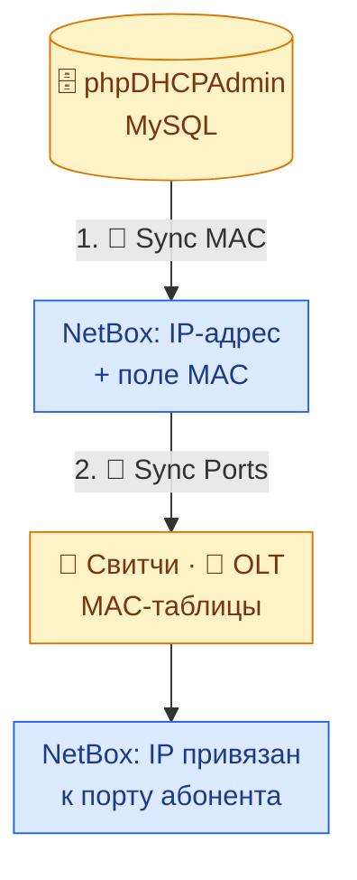
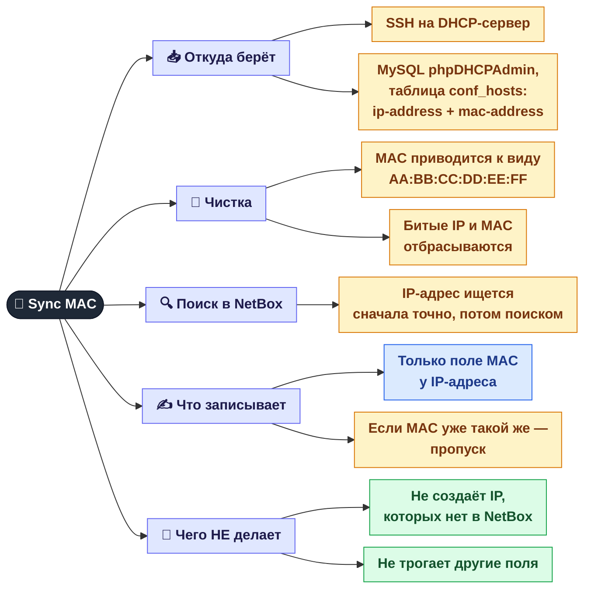
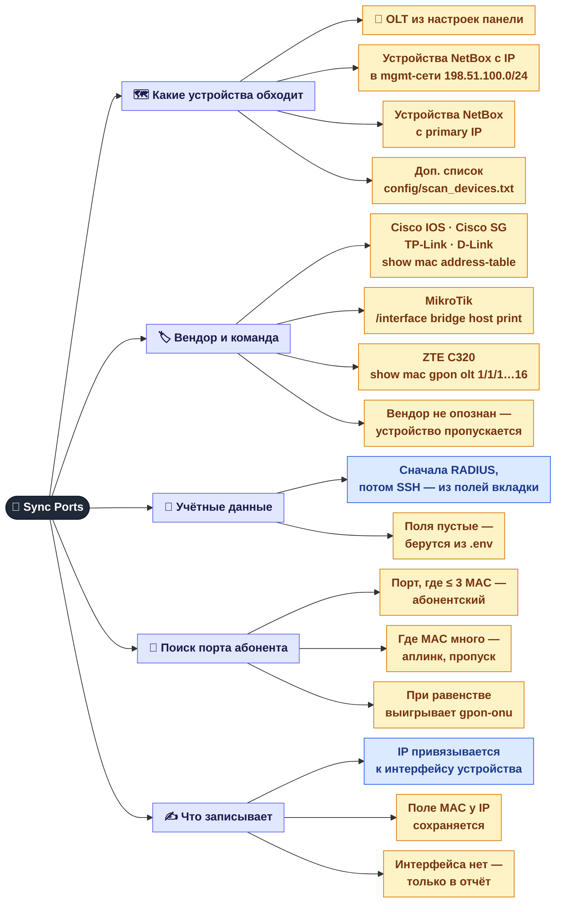
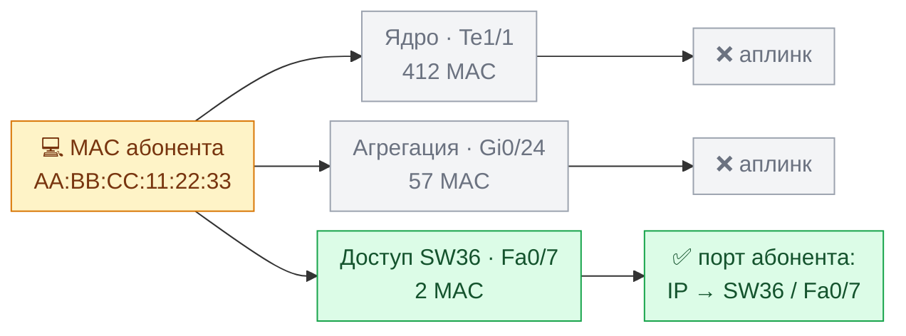

[← NetBox: обзор](06-netbox.md) · **6a** · [Карта](README.md) · [Дальше: CDP и автозаполнение →](06b-netbox-cdp.md)

# 🔄 NetBox: синхронизация MAC и портов

Две кнопки на вкладке **NetBox**, которые работают **по цепочке**:

1. **🔄 Sync MAC** — берёт пары «IP ↔ MAC» из phpDHCPAdmin и записывает MAC в NetBox.
2. **🔗 Sync Ports** — по этим MAC находит, в каком порту какого устройства сидит абонент, и привязывает его IP к этому интерфейсу в NetBox.

Порядок важен: без шага 1 у IP в NetBox нет MAC, и шагу 2 нечего искать.

---

## 1. 🔄 Sync MAC — phpDHCPAdmin → NetBox

### Как читать итог

После синхронизации появляется окно с четырьмя числами:

| Число | Что значит | Что делать |
|-------|-----------|-----------|
| **Updated** | MAC записан или исправлен | ничего |
| **Skipped** | в NetBox уже стоял тот же MAC | ничего |
| **Not found** | IP есть в DHCP, но в NetBox такого IP-адреса нет | завести IP в NetBox, если он нужен |
| **Errors** | NetBox не принял запись | смотреть лог сервиса |

---

## 2. 🔗 Sync Ports — MAC → порт абонента → NetBox

### Как определяется «порт абонента»

Один и тот же MAC абонента виден на многих устройствах: на его коммутаторе доступа, на агрегации, на ядре.
Различаются эти места тем, **сколько всего MAC на порту**. На аплинке их сотни, а на порту абонента один или два (роутер, ТВ-приставка).

Порог в 3 MAC задаётся в `.env` (`MAC_LEAF_THRESHOLD`). Если два порта подходят одинаково, выбирается тот, где MAC меньше, а при полном равенстве — `gpon-onu` (это точно конечная ONU).

### Как читать итог

Короткий итог показывается в окне, подробный — в логе:

| Статус | Что значит | Что делать |
|--------|-----------|-----------|
| **assigned** | IP привязан к новому интерфейсу | ничего |
| **already_ok** | IP уже был на правильном интерфейсе | ничего |
| **no_leaf · unseen** | MAC не найден ни на одном опрошенном устройстве | абонент выключен, или его коммутатор не опрашивается |
| **no_leaf · trunk** | MAC виден только на портах, где больше 3 MAC | за абонентом неуправляемый свитч, или порог мал |
| **iface_missing** | порт найден, но такого интерфейса нет в NetBox | завести интерфейс в NetBox |
| **dev_missing** | устройства с таким именем нет в NetBox | проверить имя устройства в NetBox |
| **failed / skipped** | устройство не опросилось: нет доступа, неверный пароль, неизвестный вендор | список с причинами — в конце лога |

### Учётные данные

На вкладке NetBox есть две пары полей: **RADIUS Login/Pass** и **SSH Login/Pass**.
Для каждого устройства сначала пробуется RADIUS, при ошибке авторизации — SSH. Если устройство просто недоступно, второй вариант не пробуется.
Если все поля пустые, используются `SSH_USERNAME` / `SSH_PASSWORD` из `.env` (для TP-Link — `TPLINK_SSH_*`).

### Настройки в `.env`

| Параметр | По умолчанию | Зачем |
|----------|:-:|-------|
| `MAC_LEAF_THRESHOLD` | `3` | сколько MAC на порту ещё считается абонентским портом |
| `MAC_MGMT_PREFIX` | — (задать в `.env`) | из какой сети брать устройства для опроса |
| `MAC_CREATE_MISSING_IFACE` | `false` | `true` — создавать недостающий интерфейс (с описанием `auto: MAC sync`) вместо записи в отчёт |
| `MAC_SCAN_DEVICES_FILE` | `config/scan_devices.txt` | доп. устройства: `ip,вендор[,имя]` в строке |
| `MAC_OLT_MAX_PORT` | `16` | сколько GPON-портов OLT опрашивать |
| `DHCP_SSH_*`, `DHCP_MYSQL_*` | — | доступ к phpDHCPAdmin для Sync MAC |

Всё это можно поменять в **Admin → Settings → .env** (нужен перезапуск панели).

## Где это в коде

| Что | Файл |
|-----|------|
| Sync MAC | `src/monitoring/dhcp_mac_sync.py` |
| Sync Ports | `src/monitoring/mac_port_sync.py` |
| Работа с NetBox | `services/netbox-autofill/netbox_client.py` |
| Эндпоинты `/api/netbox/sync-mac`, `/sync-interfaces` | `src/web/api_netbox.py` |

---
[← NetBox: обзор](06-netbox.md) · [Карта](README.md) · [Дальше: CDP и автозаполнение →](06b-netbox-cdp.md)
