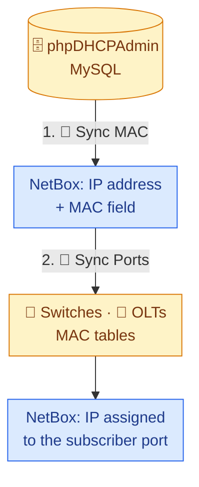
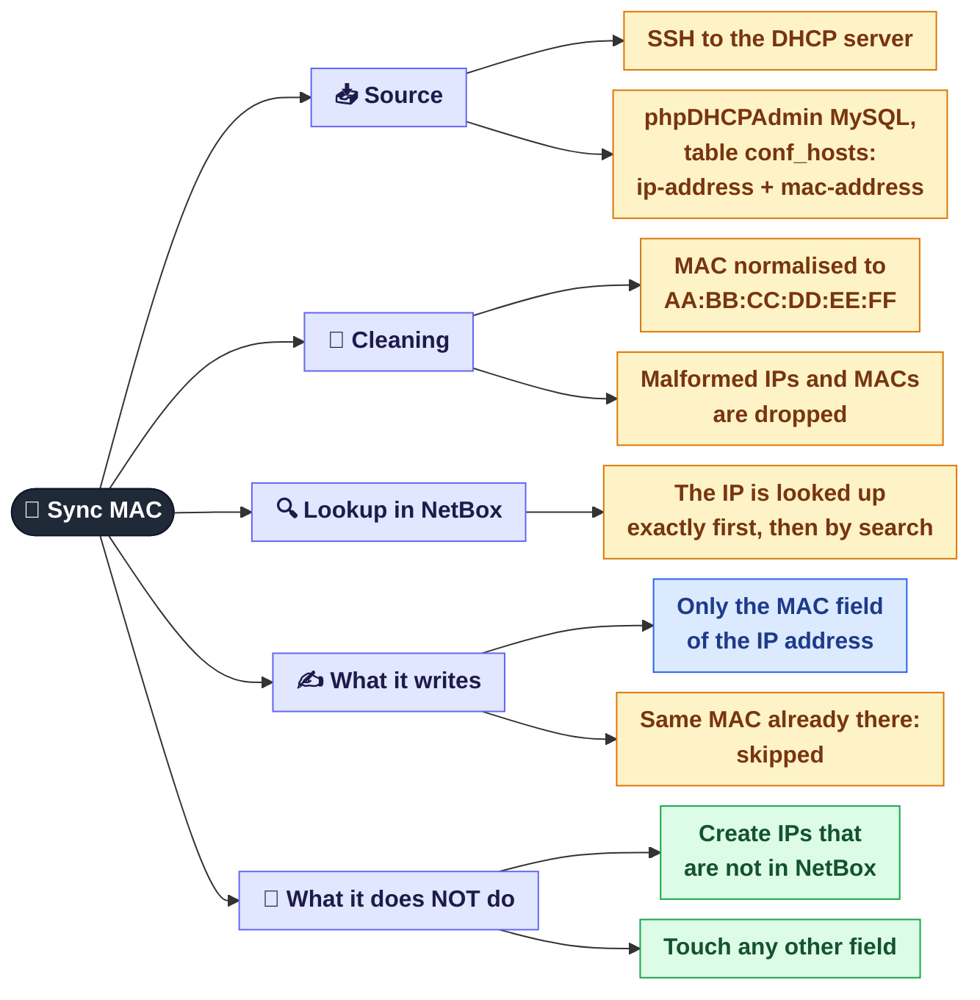
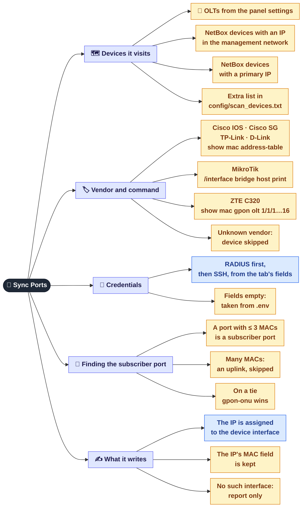

[← NetBox overview](06-netbox.md) · **6a** · [Map](README.md) · [Next: CDP and auto-fill →](06b-netbox-cdp.md)

# 🔄 NetBox: MAC and port sync

Two buttons on the **NetBox** tab that work **as a chain** (both need admin):

1. **🔄 Sync MAC** takes "IP ↔ MAC" pairs from phpDHCPAdmin and writes the MAC into NetBox.
2. **🔗 Sync Ports** uses those MACs to find which port of which device the subscriber is on, and assigns their IP to that interface in NetBox.

Order matters: without step 1 the IPs in NetBox have no MAC, and step 2 has nothing to look for.

---

## 1. 🔄 Sync MAC: phpDHCPAdmin → NetBox

### Reading the summary

After the sync a window shows four numbers:

| Number | Meaning | What to do |
|--------|---------|------------|
| **Updated** | The MAC was written or corrected | nothing |
| **Skipped** | NetBox already had the same MAC | nothing |
| **Not found** | The IP is in DHCP, but NetBox has no such IP address | add the IP to NetBox if it is needed |
| **Errors** | NetBox rejected the write | check the service log |

---

## 2. 🔗 Sync Ports: MAC → subscriber port → NetBox

### How the "subscriber port" is chosen

A subscriber's MAC is visible on many devices: their access switch, the aggregation, the core.
What tells these places apart is **how many MACs there are on the port**. An uplink has hundreds; a subscriber port has one or two (a router, a TV box).

The threshold of 3 MACs is set in `.env` (`MAC_LEAF_THRESHOLD`). If two ports qualify equally, the one with fewer MACs wins, and on a full tie `gpon-onu` wins (it is certainly an end ONU).

### Reading the summary

A short summary appears in the window, the full one in the log:

| Status | Meaning | What to do |
|--------|---------|------------|
| **assigned** | The IP was assigned to a new interface | nothing |
| **already_ok** | The IP was already on the right interface | nothing |
| **no_leaf · unseen** | The MAC was not found on any polled device | the subscriber is off, or their switch is not polled |
| **no_leaf · trunk** | The MAC is only seen on ports with more than 3 MACs | an unmanaged switch behind the subscriber, or the threshold is too low |
| **iface_missing** | The port was found, but NetBox has no such interface | add the interface in NetBox |
| **dev_missing** | NetBox has no device with that name | check the device name in NetBox |
| **failed / skipped** | The device could not be polled: unreachable, wrong password, unknown vendor | the list with reasons is at the end of the log |

### Credentials

The NetBox tab has two pairs of fields: **RADIUS Login/Pass** and **SSH Login/Pass**.
For each device RADIUS is tried first, then SSH if authentication fails. If the device is simply unreachable, the second option is not tried.
If all fields are empty, `SSH_USERNAME` / `SSH_PASSWORD` from `.env` are used (`TPLINK_SSH_*` for TP-Link).

### Settings in `.env`

| Setting | Default | Purpose |
|---------|:-:|---------|
| `MAC_LEAF_THRESHOLD` | `3` | how many MACs a port may have and still count as a subscriber port |
| `MAC_MGMT_PREFIX` | none (set it in `.env`) | which network to take devices to poll from |
| `MAC_CREATE_MISSING_IFACE` | `false` | `true` creates a missing interface (description `auto: MAC sync`) instead of reporting it |
| `MAC_SCAN_DEVICES_FILE` | `config/scan_devices.txt` | extra devices: `ip,vendor[,name]` per line |
| `MAC_OLT_MAX_PORT` | `16` | how many GPON ports of an OLT to poll |
| `DHCP_SSH_*`, `DHCP_MYSQL_*` | none | access to phpDHCPAdmin for Sync MAC |

All of these can be changed in **Admin → Settings → .env** (the panel needs a restart).

## Where it is in the code

| What | File |
|------|------|
| Sync MAC | `src/monitoring/dhcp_mac_sync.py` |
| Sync Ports | `src/monitoring/mac_port_sync.py` |
| NetBox access | `services/netbox-autofill/netbox_client.py` |
| `/api/netbox/sync-mac`, `/sync-interfaces` endpoints | `src/web/api_netbox.py` |

---
[← NetBox overview](06-netbox.md) · [Map](README.md) · [Next: CDP and auto-fill →](06b-netbox-cdp.md)
