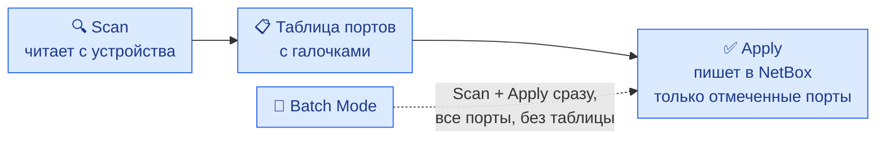
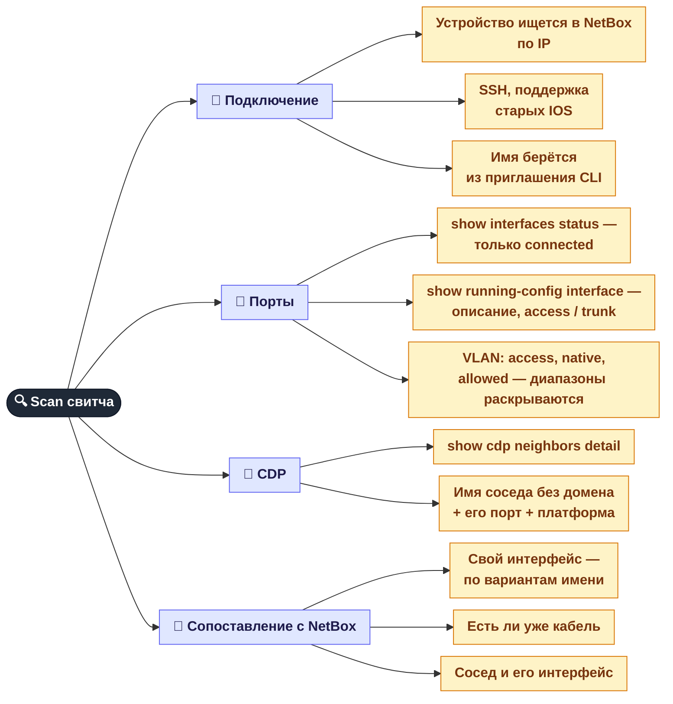
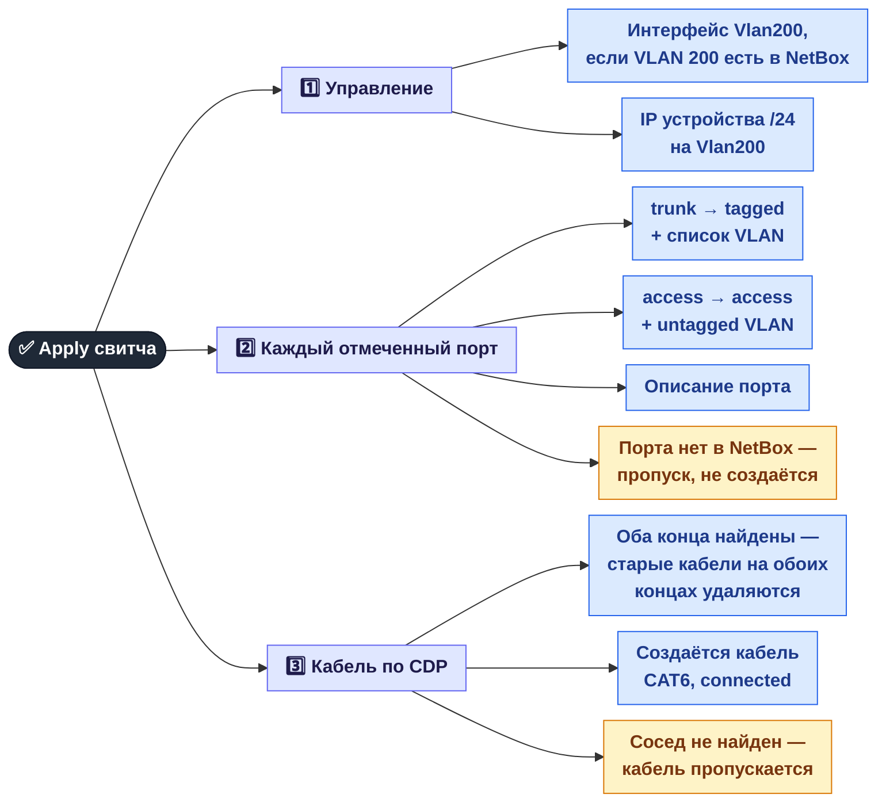
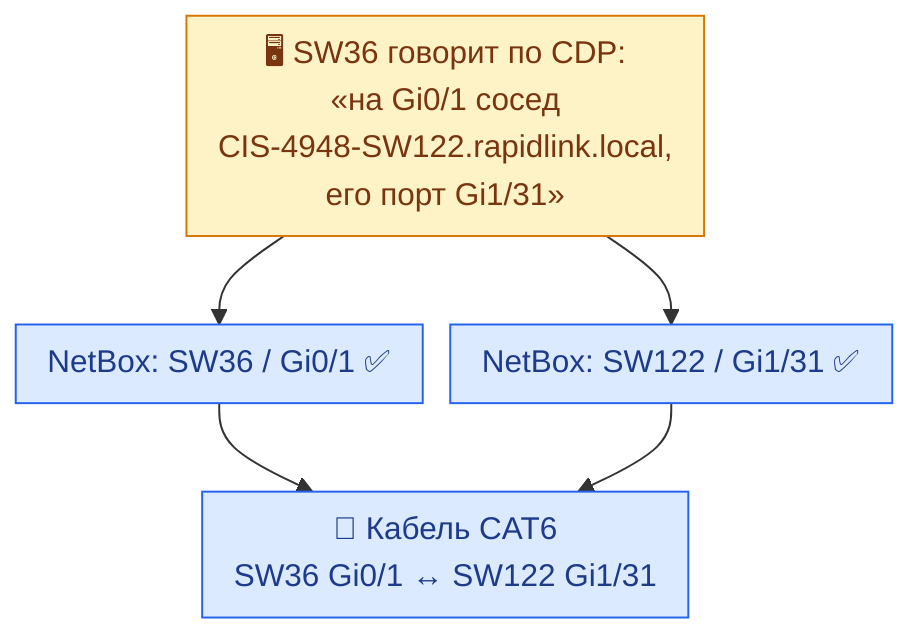
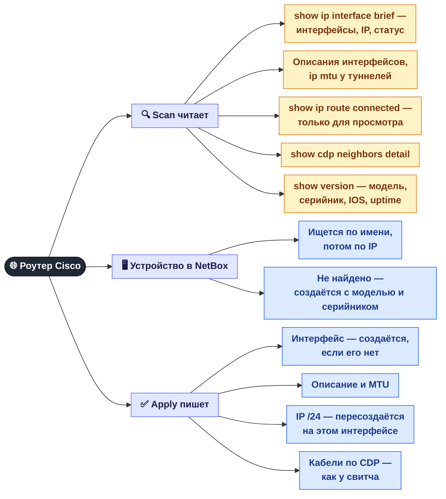

[← Синхронизация MAC](06a-netbox-mac-sync.md) · **6b** · [Карта](README.md) · [Дальше: Отключения света и воды →](07-outages.md)

# 🔗 NetBox: CDP и автозаполнение со свитчей и роутеров

Режим **Single Device** (и **Batch Mode**) на вкладке **NetBox**. Панель заходит на Cisco по SSH, читает настройки портов и соседей по **CDP** и переносит это в NetBox: режимы портов, VLAN, описания, IP и **кабели между устройствами**.

**CDP** (Cisco Discovery Protocol) — каждое Cisco-устройство сообщает соседям своё имя и порт. Поэтому свитч знает: «на моём Gi0/1 сидит SW122, его порт Gi1/31». По этим данным панель и прокладывает кабели в NetBox.

## Работа в два шага

---

## 🔀 Свитч: что читается при Scan

### Как находится сосед в NetBox

Имя из CDP и имя в NetBox часто отличаются (например, `CIS-NX3K-SW36-N.TST` против `CIS-NX3K-SW36-ECB`). Поэтому сосед ищется в три попытки:

1. **точное имя** (домен уже отрезан);
2. **по номеру свитча** `SWnn`; если таких устройств несколько — уточняется по модели (`NX3K`, `4948`, `2950`…);
3. **по началу имени**, отрезая части с конца — пока не останется ровно одно совпадение.

Имя порта тоже пробуется в разных написаниях: `Gi0/1` ↔ `GigabitEthernet0/1`, `[Gi]1/46`, `Fa1/0/1` ↔ `Fa1/01`, `Eth1/N` и т. д.

## 🔀 Свитч: что пишется при Apply

### Пример: из CDP в кабель NetBox

---

## 🌐 Роутер: Scan и Apply

## Свитч и роутер: в чём разница

| | 🔀 Свитч | 🌐 Роутер |
|---|---|---|
| Какие порты берутся | только `connected` | все из `show ip interface brief` |
| Нет устройства в NetBox | Scan предупреждает, Apply ничего не запишет | создаётся новое устройство |
| Нет интерфейса в NetBox | порт пропускается | интерфейс создаётся |
| VLAN | режим и VLAN пишутся | не пишутся |
| IP | только управляющий IP на Vlan200 | IP каждого интерфейса |
| Кабели по CDP | да, CAT6 | да, CAT6 |
| Batch Mode | есть | нет |

## ⚠️ Что важно знать перед Apply

| Поведение | Почему важно |
|-----------|-------------|
| **Scan уже меняет NetBox:** если имя устройства в NetBox не совпадает с hostname из CLI, устройство переименовывается сразу при сканировании, ещё до Apply | Scan — не «только чтение» |
| **Кабели перезаписываются:** перед созданием нового кабеля старые кабели на **обоих** концах удаляются | ручные правки кабелей на этих портах пропадут |
| **Тип кабеля всегда CAT6**, даже если это оптика | тип придётся поправить руками |
| **Маска всегда /24:** и для Vlan200 у свитча, и для IP у роутера | для других масок IP будет записан неверно |
| **IP роутера пересоздаётся:** существующие записи с этим адресом удаляются и создаются заново | пропадают custom-поля этого IP, в том числе `MAC` из [Sync MAC](06a-netbox-mac-sync.md) |
| **Поиск соседа по `SWnn` нечёткий:** при нескольких похожих именах может выбраться не то устройство | стоит проверить таблицу портов перед Apply |
| **Batch Mode применяет все порты без просмотра** | для незнакомых устройств лучше Single Device |

## Где это в коде

| Что | Файл |
|-----|------|
| SSH к Cisco, разбор CLI и CDP | `services/netbox-autofill/ssh_connector.py` |
| Scan и Apply свитча | `services/netbox-autofill/orchestrator.py` |
| Поиск устройств и интерфейсов, кабели | `services/netbox-autofill/netbox_client.py` |
| Scan и Apply роутера, Batch | `src/web/api_netbox.py` |
| Вкладка NetBox | `web/js/netbox.js` |

---
[← Синхронизация MAC](06a-netbox-mac-sync.md) · [Карта](README.md) · [Дальше: Отключения света и воды →](07-outages.md)
