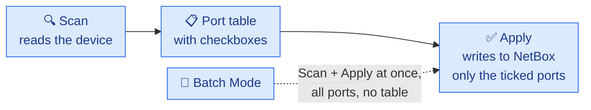
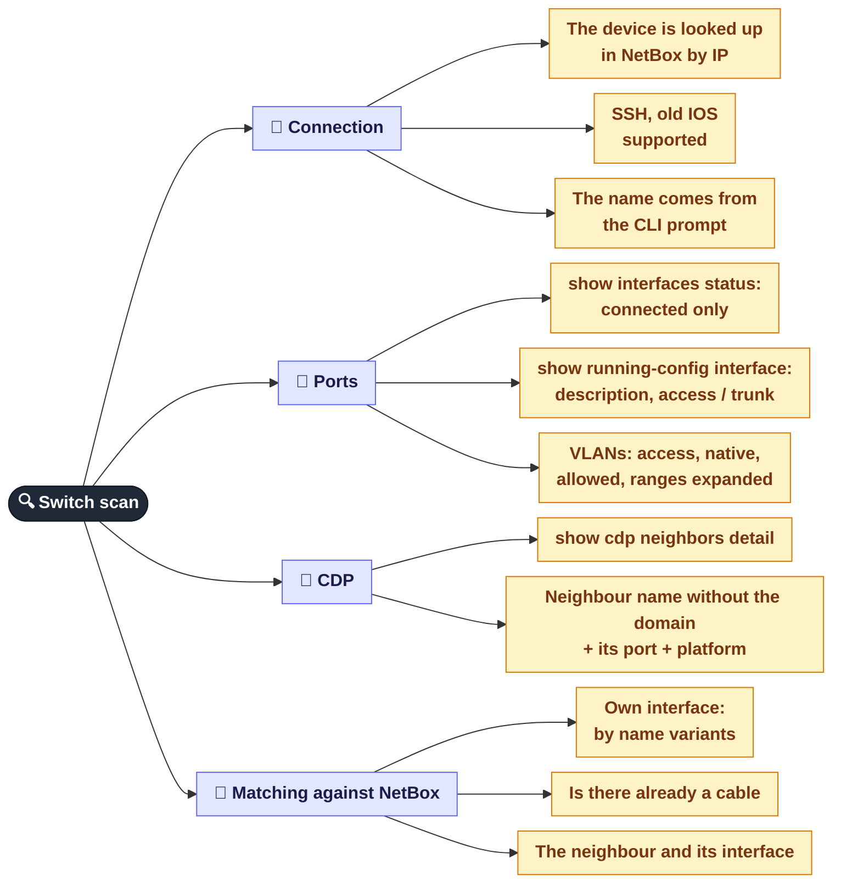
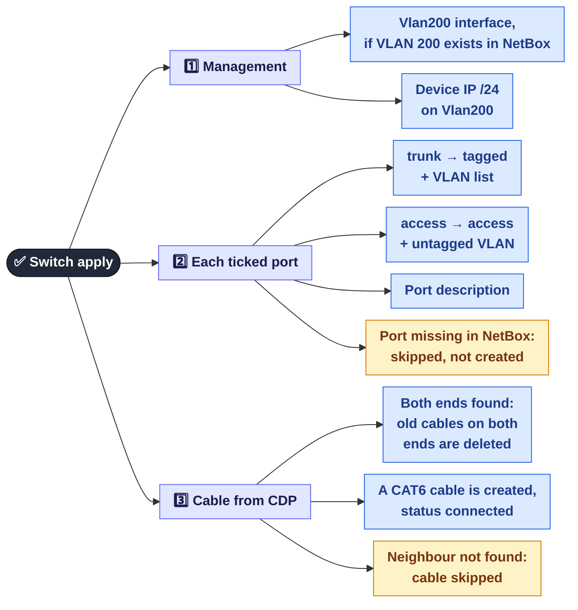
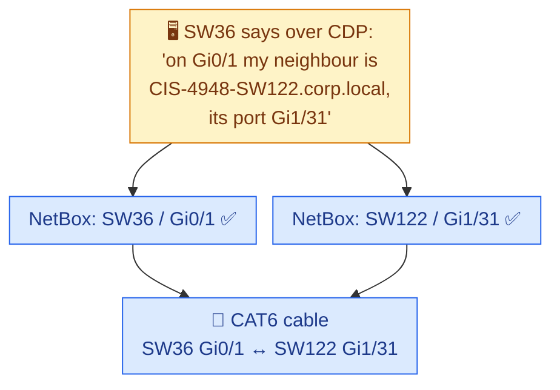
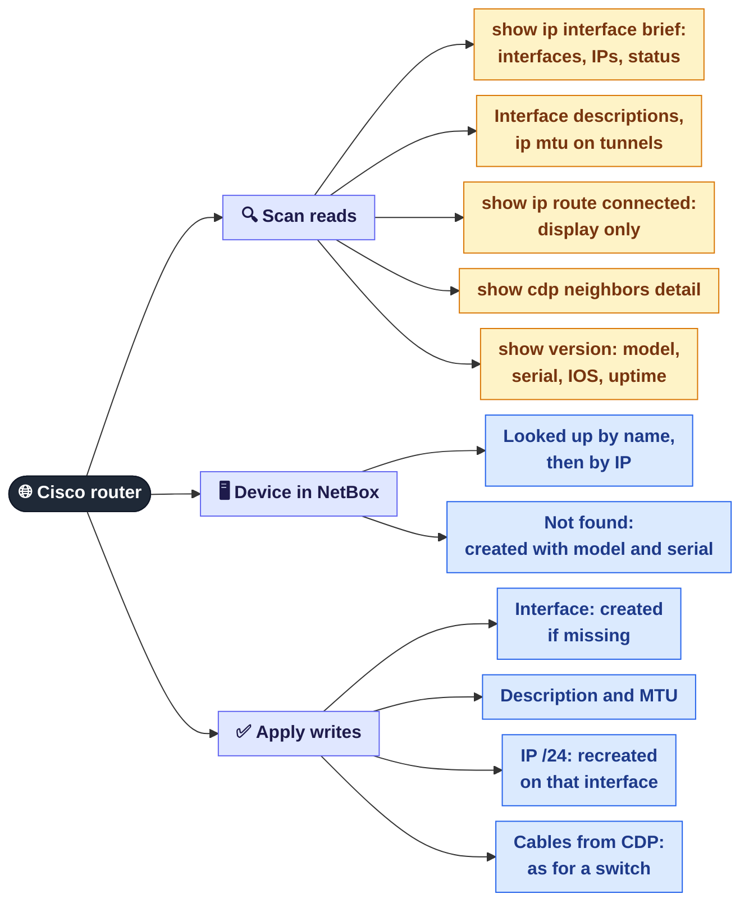

[← MAC sync](06a-netbox-mac-sync.md) · **6b** · [Map](README.md) · [Next: Power and water outages →](07-outages.md)

# 🔗 NetBox: CDP and auto-fill from switches and routers

**Single Device** mode (and **Batch Mode**) on the **NetBox** tab. The panel signs in to a Cisco device over SSH, reads the port settings and the **CDP** neighbours, and carries them over to NetBox: port modes, VLANs, descriptions, IPs and **cables between devices**.

**CDP** (Cisco Discovery Protocol): every Cisco device tells its neighbours its name and port. So a switch knows "on my Gi0/1 sits SW122, on its port Gi1/31". The panel lays the cables in NetBox from exactly this data.

## Two steps

---

## 🔀 Switch: what Scan reads

### How the neighbour is found in NetBox

The name from CDP and the name in NetBox often differ (for example `CIS-NX3K-SW36-N.TST` versus `CIS-NX3K-SW36-ECB`). So the neighbour is looked up in three attempts:

1. **the exact name** (domain already stripped);
2. **by switch number** `SWnn`; if several devices match, the model narrows it down (`NX3K`, `4948`, `2950`…);
3. **by name prefix**, trimming parts from the end until exactly one match is left.

The port name is also tried in different spellings: `Gi0/1` ↔ `GigabitEthernet0/1`, `[Gi]1/46`, `Fa1/0/1` ↔ `Fa1/01`, `Eth1/N` and so on.

## 🔀 Switch: what Apply writes

### Example: from CDP to a NetBox cable

---

## 🌐 Router: Scan and Apply

## Switch versus router

| | 🔀 Switch | 🌐 Router |
|---|---|---|
| Ports taken | `connected` only | everything in `show ip interface brief` |
| Device missing in NetBox | Scan warns, Apply writes nothing | a new device is created |
| Interface missing in NetBox | the port is skipped | the interface is created |
| VLANs | mode and VLANs are written | not written |
| IPs | only the management IP on Vlan200 | the IP of every interface |
| Cables from CDP | yes, CAT6 | yes, CAT6 |
| Batch Mode | yes | no |

## ⚠️ What to know before Apply

| Behaviour | Why it matters |
|-----------|----------------|
| **Scan already changes NetBox:** if the device name in NetBox differs from the CLI hostname, the device is renamed during the scan, before Apply | Scan is not read-only, which is why it needs admin |
| **Cables are overwritten:** before a new cable is created, the old cables on **both** ends are deleted | manual cable edits on those ports are lost |
| **The cable type is always CAT6**, even for fibre | the type has to be fixed by hand |
| **The mask is always /24:** both for the switch's Vlan200 and for router IPs | IPs in other masks are recorded wrongly |
| **Router IPs are recreated:** existing records with that address are deleted and created again | the IP's custom fields are lost, including the `MAC` from [Sync MAC](06a-netbox-mac-sync.md) |
| **The `SWnn` neighbour lookup is fuzzy:** with several similar names the wrong device can be picked | check the port table before Apply |
| **Batch Mode applies every port without a preview** | prefer Single Device for unfamiliar devices |

## Where it is in the code

| What | File |
|------|------|
| SSH to Cisco, CLI and CDP parsing | `services/netbox-autofill/ssh_connector.py` |
| Switch Scan and Apply | `services/netbox-autofill/orchestrator.py` |
| Device and interface lookup, cables | `services/netbox-autofill/netbox_client.py` |
| Router Scan and Apply, Batch | `src/web/api_netbox.py` |
| NetBox tab | `web/js/netbox.js` |

---
[← MAC sync](06a-netbox-mac-sync.md) · [Map](README.md) · [Next: Power and water outages →](07-outages.md)
