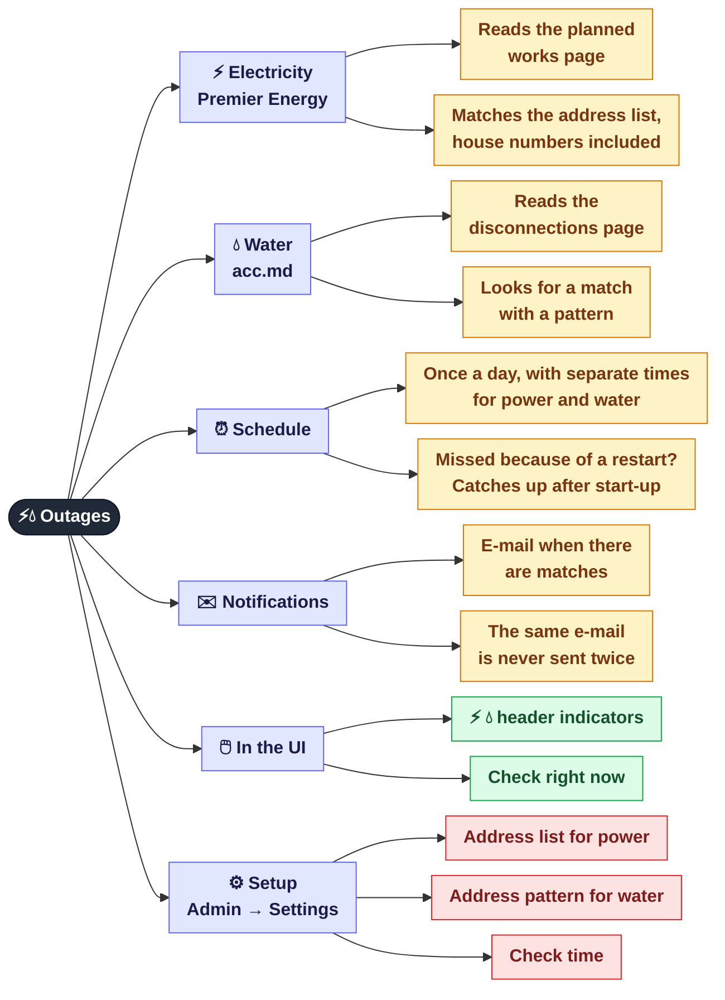
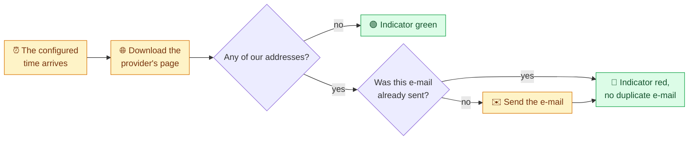

[← CDP and auto-fill](06b-netbox-cdp.md) · **7 / 8** · [Map](README.md) · [Next: Superadmin console →](08-admin.md)

# ⚡💧 Power and water outages

Once a day the panel reads the utility providers' websites and sends an e-mail if a planned outage affects our addresses.

## A day in the life of a check

> Mail settings (SMTP, recipients) live in `.env`. They can be edited in **Admin → Settings → .env**; see [👑 Superadmin console](08-admin.md).
> Instead of the built-in schedule you can use the systemd timers in `scripts/`, but **not both** for the same channel.

## Where it is in the code

| What | File |
|------|------|
| Power: Premier Energy | `src/monitoring/electric_monitor.py`, addresses in `config/electric_addresses.txt` |
| Water: acc.md | `src/monitoring/acc_monitor.py` |
| Built-in schedule | `src/monitoring/outage_scheduler.py` |
| Settings changed at runtime | `src/web/runtime_config.py` |
| `/api/electric/*`, `/api/acc/*` endpoints | `src/web/routes/utilities.py` |

---
[← CDP and auto-fill](06b-netbox-cdp.md) · [Map](README.md) · [Next: Superadmin console →](08-admin.md)
