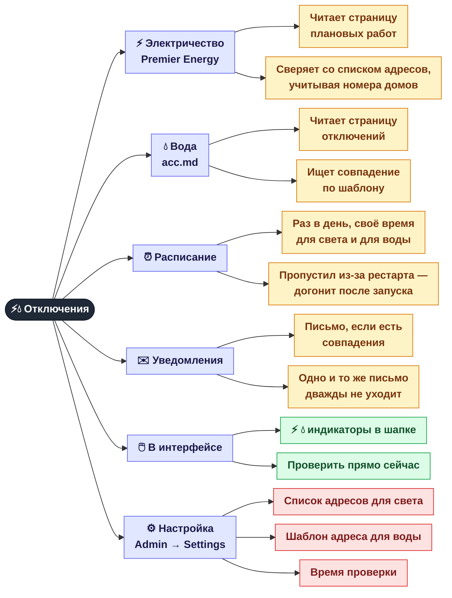
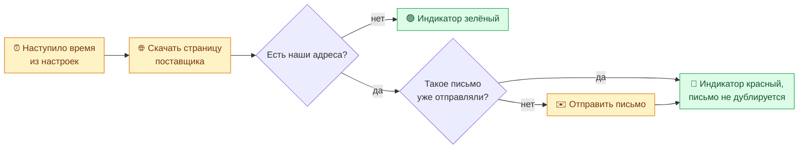

[← CDP и автозаполнение](06b-netbox-cdp.md) · **7 / 8** · [Карта](README.md) · [Дальше: Консоль superadmin →](08-admin.md)

# ⚡💧 Отключения света и воды

Панель раз в день читает сайты поставщиков и предупреждает по почте, если плановое отключение затронет наши адреса.

## Один день из жизни проверки

> Почтовые настройки (SMTP, получатели) лежат в `.env`. Их можно поправить во вкладке **Admin → Settings → .env** — см. [👑 Консоль superadmin](08-admin.md).
> Вместо встроенного расписания можно использовать systemd-таймеры из `scripts/`, но **не оба сразу** для одного канала.

## Где это в коде

| Что | Файл |
|-----|------|
| Свет — Premier Energy | `src/monitoring/electric_monitor.py`, адреса в `config/electric_addresses.txt` |
| Вода — acc.md | `src/monitoring/acc_monitor.py` |
| Встроенное расписание | `src/monitoring/outage_scheduler.py` |
| Настройки, меняемые на лету | `src/web/runtime_config.py` |

---
[← CDP и автозаполнение](06b-netbox-cdp.md) · [Карта](README.md) · [Дальше: Консоль superadmin →](08-admin.md)
