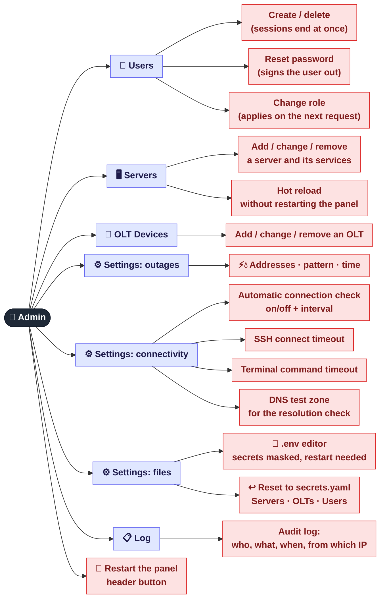
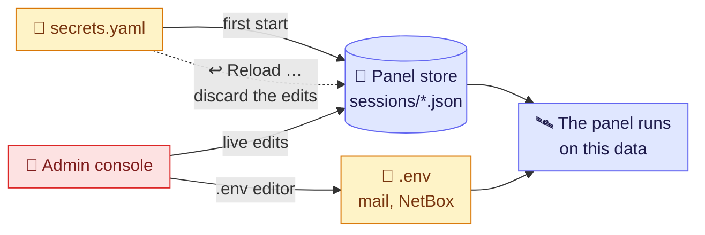

[← Power and water outages](07-outages.md) · **8 / 8** · [Map](README.md)

# 👑 Superadmin console

The **Admin** tab is visible to superadmins only. Five sub-tabs cover everything that used to mean editing files on the server.
Changes apply **immediately**, without a restart (except `.env`).

## Where the panel gets its settings

> ⚠️ After the first start the **panel store** is the source of truth, not `secrets.yaml`.
> Editing `secrets.yaml` changes nothing until you press **Reload Servers / OLTs / Users**.

## Where it is in the code

| What | File |
|------|------|
| `/api/admin/*` endpoints | `src/web/admin.py` |
| Store for settings, servers, OLTs | `src/web/runtime_config.py` |
| Safe `.env` writes | `src/web/env_config.py` |
| Audit log | `src/web/audit.py` |
| Admin tab | `web/js/admin.js` |

---
[← Power and water outages](07-outages.md) · [Map](README.md)
