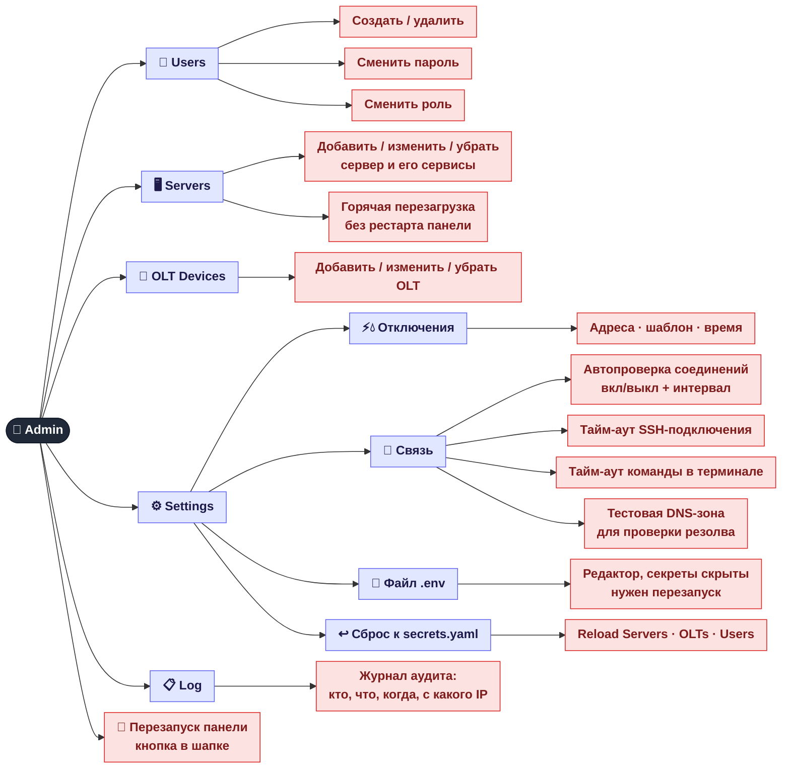
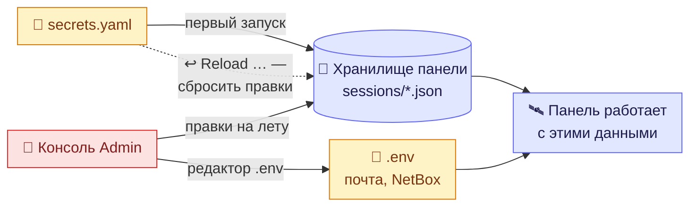

[← Отключения света и воды](07-outages.md) · **8 / 8** · [Карта](README.md)

# 👑 Консоль superadmin

Вкладка **Admin** видна только superadmin. Пять подвкладок — всё, что раньше приходилось править в файлах на сервере.
Изменения применяются **на лету**, без перезапуска (кроме `.env`).

## Откуда панель берёт настройки

> ⚠️ После первого запуска главным становится **хранилище панели**, а не `secrets.yaml`.
> Правка `secrets.yaml` ничего не изменит, пока не нажать **Reload Servers / OLTs / Users**.

## Где это в коде

| Что | Файл |
|-----|------|
| Эндпоинты `/api/admin/*` | `src/web/admin.py` |
| Хранилище настроек, серверов, OLT | `src/web/runtime_config.py` |
| Безопасная запись `.env` | `src/web/env_config.py` |
| Журнал аудита | `src/web/audit.py` |
| Вкладка Admin | `web/js/admin.js` |

---
[← Отключения света и воды](07-outages.md) · [Карта](README.md)
