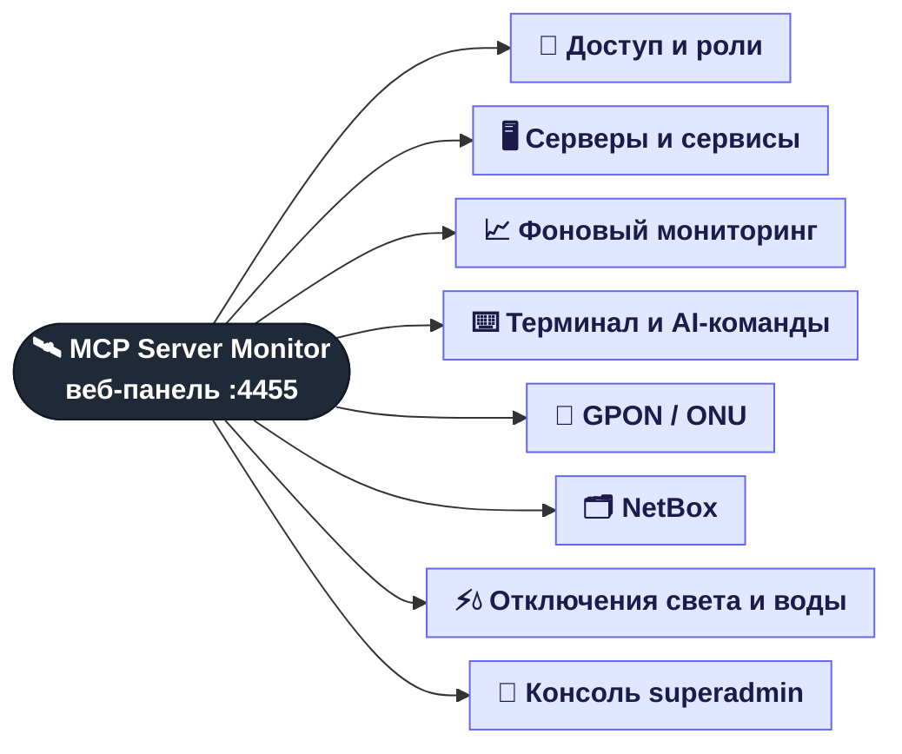
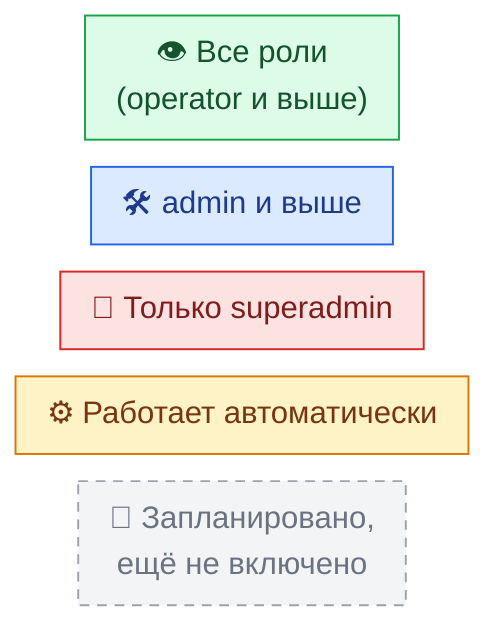

# 🌳 Карта возможностей MCP Server Monitor

Приложение большое, поэтому возможности разбиты на **8 отдельных деревьев**.
Здесь — только верхний уровень. Открывайте нужную ветку, внутри каждой — подробное дерево «что, где и зачем».

| # | Дерево | Что внутри | Вкладка в UI |
|:-:|--------|-----------|--------------|
| 1 | [🔐 Доступ и роли](01-access.md) | вход, сессии, 3 роли, смена пароля, аудит | экран входа, шапка |
| 2 | [🖥️ Серверы и сервисы](02-servers.md) | карточки серверов, DHCP / DNS / RADIUS, отчёт о сервере | **Servers** |
| 3 | [📈 Фоновый мониторинг](03-monitoring.md) | слежение за логами, распознавание ошибок, health-check, индикаторы в шапке | работает само, видно в шапке |
| 4 | [⌨️ Терминал и AI-команды](04-terminal.md) | команды обычным языком через Claude, прямая SSH-консоль | **Servers → Terminal Interpretation** |
| 5 | [📡 GPON / ONU](05-onu.md) | OLT ZTE C320, оптический сигнал, регистрация ONU, поиск и фильтры | **ONU** |
| 6 | [🗂️ NetBox](06-netbox.md) | автозаполнение NetBox со свитчей и роутеров, синхронизация MAC и портов | **NetBox** |
| 6a | ↳ [🔄 Синхронизация MAC и портов](06a-netbox-mac-sync.md) | phpDHCPAdmin → MAC → порт абонента, разбор отчёта | **NetBox → Sync MAC / Sync Ports** |
| 6b | ↳ [🔗 CDP и автозаполнение](06b-netbox-cdp.md) | что читается с Cisco, как строятся кабели, что пишется в NetBox | **NetBox → Single Device / Batch** |
| 7 | [⚡💧 Отключения света и воды](07-outages.md) | Premier Energy, acc.md, расписание проверок, письма | шапка ⚡ 💧, **Admin → Settings** |
| 8 | [👑 Консоль superadmin](08-admin.md) | пользователи, серверы, OLT, настройки, `.env`, журнал аудита | **Admin** |

## 🎨 Как читать деревья

Во всех деревьях цвет листа показывает, **кому доступна функция**:

> Архитектура «изнутри» (модули, потоки данных) описана отдельно — в [ARCHITECTURE.md](../ARCHITECTURE.md).
> Эти деревья — взгляд **пользователя**: что приложение умеет и где это найти.
