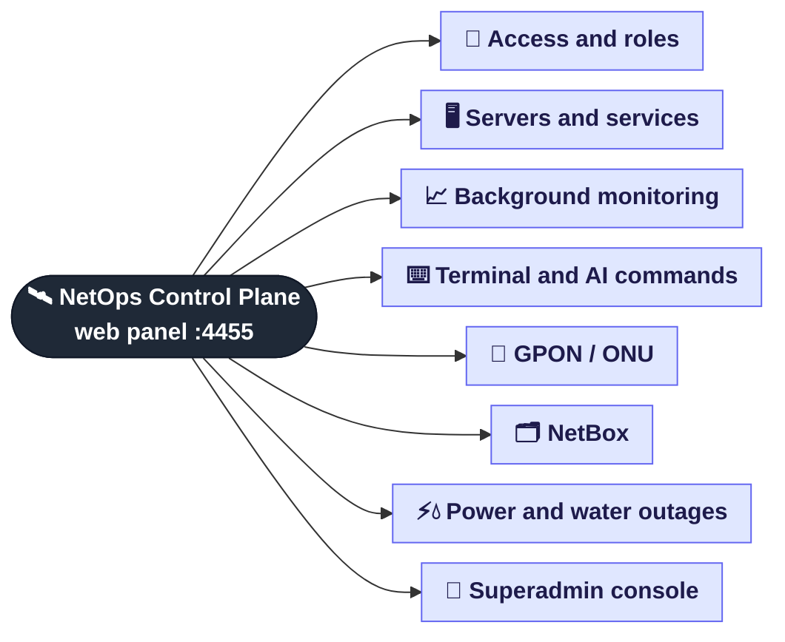
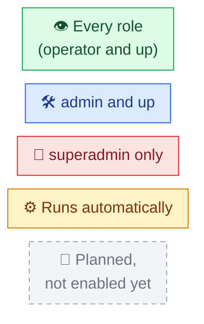

# 🌳 NetOps Control Plane feature map

The app does a lot, so its features are split into **8 separate trees**.
This page is the top level only. Open a branch to see a detailed tree of what it does, where to find it and why it exists.

| # | Tree | What's inside | Where in the UI |
|:-:|------|---------------|-----------------|
| 1 | [🔐 Access and roles](01-access.md) | sign-in, sessions, 3 roles, password change, audit | sign-in screen, header |
| 2 | [🖥️ Servers and services](02-servers.md) | server cards, DHCP / DNS / RADIUS, server report | **Servers** |
| 3 | [📈 Background monitoring](03-monitoring.md) | log watching, error recognition, incidents and fixes, health checks, header indicators | runs on its own; **Servers → Incidents**, header |
| 4 | [⌨️ Terminal and AI commands](04-terminal.md) | plain-language commands via Claude, risk policy and confirmation, raw SSH console | **Servers → Terminal Interpretation** |
| 5 | [📡 GPON / ONU](05-onu.md) | ZTE C320 OLTs, optical signal, ONU registration, search and filters | **ONU** |
| 6 | [🗂️ NetBox](06-netbox.md) | NetBox auto-fill from switches and routers, MAC and port sync | **NetBox** |
| 6a | ↳ [🔄 MAC and port sync](06a-netbox-mac-sync.md) | phpDHCPAdmin → MAC → subscriber port, reading the report | **NetBox → Sync MAC / Sync Ports** |
| 6b | ↳ [🔗 CDP and auto-fill](06b-netbox-cdp.md) | what is read from Cisco, how cables are built, what is written to NetBox | **NetBox → Single Device / Batch** |
| 7 | [⚡💧 Power and water outages](07-outages.md) | Premier Energy, acc.md, check schedule, e-mails | header ⚡ 💧, **Admin → Settings** |
| 8 | [👑 Superadmin console](08-admin.md) | users, servers, OLTs, settings, `.env`, audit log | **Admin** |

## 🎨 How to read the trees

In every tree the colour of a leaf shows **who can use the feature**:

> The internals (modules, data flows) are described in [ARCHITECTURE.md](../ARCHITECTURE.md).
> These trees are the **user's** view: what the app can do and where to find it.
